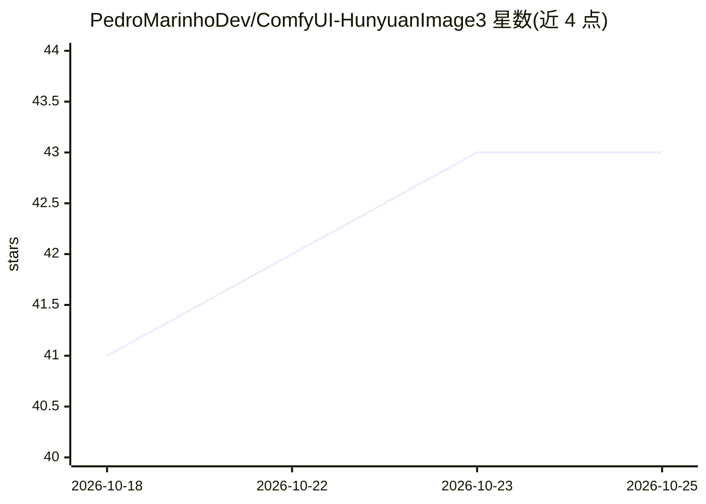

# PedroMarinhoDev/ComfyUI-HunyuanImage3

⭐ 44 · Python · GPL-3.0 · 推送 2026-10-25 · [GitHub](https://github.com/PedroMarinhoDev/ComfyUI-HunyuanImage3) · 个人维护

**在 ComfyUI 中单卡 24GB 原生运行腾讯 HunyuanImage-3.0 的节点包**

ComfyUI 自定义节点包，将腾讯 80B MoE 文生图模型 HunyuanImage-3.0（Instruct-Distil/Instruct/Base 三个变体）接入 ComfyUI 原生工作流，支持文生图、图像编辑、最多三图融合与提示词改写，并提供可选 Spectrum 提速（50 步模型约 3.4 倍）。权重经量化（W4A8 约 44GB / int8 / bf16）从系统内存按步流式加载到 GPU，最低 12GB 显存即可运行，但需约 50GB 空闲系统内存与快速 SSD。安装仅需 git clone 到 custom_nodes 目录，无需 pip 依赖，权重从 HuggingFace 下载。

## 筛选速览

| 维度 | 判定 | 备注 |
|---|---|---|
| AI 角色 | `ai-native` | 本体是模型或模型工具 |
| 许可风险 | `viral` | GPL-3.0 |
| 部署形态 | `library` | 以包/库形式分发 |
| 模型依赖 | — | README 未给出锁定关系 |
| 硬件要求 | — | 无带数字的原话,不猜 |
| 安装摩擦 | `medium` | 含编译或系统依赖之一 |
| 成熟度 | — | 结构信号不足 |

## 能力要点

- 单卡 12–24GB 显存运行 80B MoE 模型，权重按步从系统内存流式加载
- 三个模型变体与三种权重量化格式（W4A8/int8/bf16），并提供量化误差对比数据
- 支持文生图、图像编辑、三图融合与提示词改写节点
- Spectrum 可选提速使 50 步模型约 3.4 倍速度

## 适用场景

- 在 ComfyUI 工作流中用单张消费级显卡生成或编辑图像
- 用 8 步 Instruct-Distil 变体快速出图（约 26 秒/张）
- 在 12–16GB 显存的小卡上以相同效果运行大模型

## 场景标签

`图像生成` · 领域:内容生成

## 证据(README 行号)

> L3: Run Tencent's **HunyuanImage-3.0**, an 80-billion-parameter
> L4: image model, **natively in ComfyUI on a single 24 GB GPU**. Use the normal KSampler, the normal VAE Decode
> L16: - **All three HunyuanImage-3.0 models**: the fast 8-step **Instruct-Distil**, the full **Instruct**, and the

## 星数曲线

2026-10-18 41 → 2026-10-25 43（+2）

---
*卡片 v1 · prompt 1.4 · 生成 2026-10-25 · 置信度 mid · 依据 README sha `052e289581d5` · [字段定义](../../DATASET.md)*
