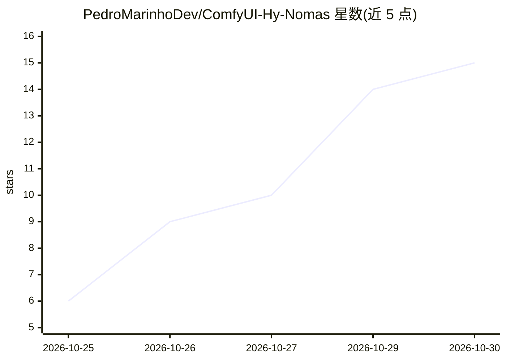

# PedroMarinhoDev/ComfyUI-Hy-Nomas

⭐ 15 · Python · GPL-3.0 · 推送 2026-10-25 · [GitHub](https://github.com/PedroMarinhoDev/ComfyUI-Hy-Nomas) · [官网](https://huggingface.co/PedroMarinhoDev/Hy-Nomas-ComfyUI) · 个人维护

**在 ComfyUI 中原生运行腾讯 Hy-Nomas 视频世界模型的节点集**

将腾讯 Hy-Nomas 视频世界模型接入 ComfyUI 的自定义节点：DiT 以原生 MODEL 形式由内置 KSampler 采样，基于腾讯 INT8 蒸馏权重与 FP8 解码器，在 12 GB 显存显卡上运行。世界按数秒段落逐段生成，后续段落通过缓存键值记忆前文，可从文本或自有图片起始、无限续接段落，并支持 W/A/S/D 摄像机控制与键盘实时 Drive 模式。无需额外 pip 依赖，通过 ComfyUI-Manager、Comfy Registry 或 git clone 安装，需下载约 27 GB 权重。项目自述为进行中（work in progress），节点接口可能变动。

## 筛选速览

| 维度 | 判定 | 备注 |
|---|---|---|
| AI 角色 | `ai-native` | 本体是模型或模型工具 |
| 许可风险 | `viral` | GPL-3.0 |
| 部署形态 | `library` | 以包/库形式分发 |
| 模型依赖 | — | README 未给出锁定关系 |
| 硬件要求 | `gpu-8g` | |
| 安装摩擦 | `low` | 无编译、无系统依赖或容器化 |
| 成熟度 | `idea` | |

## 能力要点

- 段落式世界生成，键值历史缓存实现跨段落记忆续接
- 从文本或自有图片起始，图片经编码成为世界的第 0 段
- 摄像机控制（录制路径/按键时间线）与键盘交互式 Drive 模式
- INT8 张量核 GEMM、融合核与 FP8 解码器，12 GB 显存可用

## 适用场景

- 在 ComfyUI 工作流中从提示词或一张图片生成多段落视频世界
- 用键盘实时转向探索模型生成的世界
- 在消费级显卡（12 GB 起）上运行视频世界模型

## 场景标签

`视频生成` · 领域:内容生成

## 证据(README 行号)

> L15: Run Tencent's **Hy-Nomas** video world model **natively in ComfyUI**: a
> L18: you like, or **drive** it with the keyboard turn by turn. The DiT is a native ComfyUI `MODEL` sampled by the stock
> L19: `KSampler` and streamed by ComfyUI's own memory management, on Tencent's INT8 distilled weights; it runs on 12 GB

## 星数曲线

2026-10-25 6 → 2026-10-30 15（+9）

---
*卡片 v1 · prompt 1.4 · 生成 2026-10-30 · 置信度 mid · 依据 README sha `32b95bac8d6e` · [字段定义](../../DATASET.md)*
