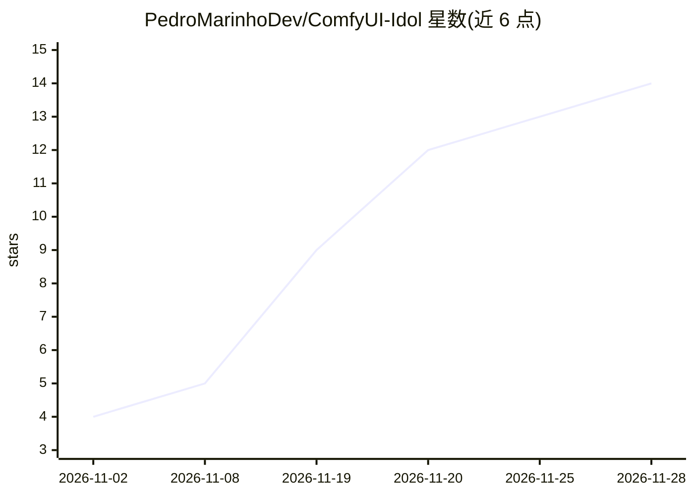

# PedroMarinhoDev/ComfyUI-Idol

⭐ 14 · Python · GPL-3.0 · 推送 2026-10-30 · [GitHub](https://github.com/PedroMarinhoDev/ComfyUI-Idol) · [官网](https://huggingface.co/PedroMarinhoDev/Idol-ComfyUI) · 个人维护

**让 ComfyUI 用户用一张图原生生成 3D 高斯泼溅的节点包**

在 ComfyUI 中原生运行 speridlabs 的 Idol 模型：输入一张物体图片，生成完整 3D 高斯泼溅（默认 262,144 个高斯，最多 1,048,576），输出标准 .ply、输入视角渲染与转台视频。复用 ComfyUI 自带的 TripoSplat 节点、KSampler 与内存管理，另补三个节点（预处理、输入相机、精度控制）。无 pip 依赖，模型权重从 Hugging Face 下载；要求 ComfyUI v0.43+ 与原生 TripoSplat 节点，实测 VRAM 峰值约 5.8 GB。

## 筛选速览

| 维度 | 判定 | 备注 |
|---|---|---|
| AI 角色 | `ai-native` | 本体是模型或模型工具 |
| 许可风险 | `viral` | GPL-3.0 |
| 部署形态 | `library` | 以包/库形式分发 |
| 模型依赖 | — | README 未给出锁定关系 |
| 硬件要求 | `gpu-8g` | |
| 安装摩擦 | `low` | 无编译、无系统依赖或容器化 |
| 成熟度 | — | 结构信号不足 |

## 能力要点

- 一张图片生成含背面与侧面的 3DGS .ply（最多 1,048,576 高斯）
- 复用 ComfyUI 原生 TripoSplat 节点、KSampler 与内存管理，非 SDK 封装
- 预测输入图片的相机视角，支持从该视角开始的转台渲染
- 提供 fp16 默认、fp32+fp16 attention、全 fp32 三档精度预设

## 适用场景

- 从单张产品图或渲染图生成可导入的 3D 物体模型
- 在 ComfyUI 工作流中把图生 3D 与其他生成节点串联
- 照片与合成图分别用 real/synthetic 模式做重建

## 场景标签

 · 领域:AIGC/3D 生成

## 证据(README 行号)

> L13: Run **Idol** by speridlabs **natively in ComfyUI**: give it one picture of an
> L15: never showed. Idol is TripoSplat's architecture with its own weights, so it runs on ComfyUI's own TripoSplat nodes,
> L23:  One picture in, the whole object out The back and the sides are generated to match the front, as a standard 3DGS <

## 星数曲线

2026-11-02 4 → 2026-11-28 14（+10）

---
*卡片 v1 · prompt 1.4 · 生成 2026-11-20 · 置信度 mid · 依据 README sha `8983a74e139b` · [字段定义](../../DATASET.md)*
