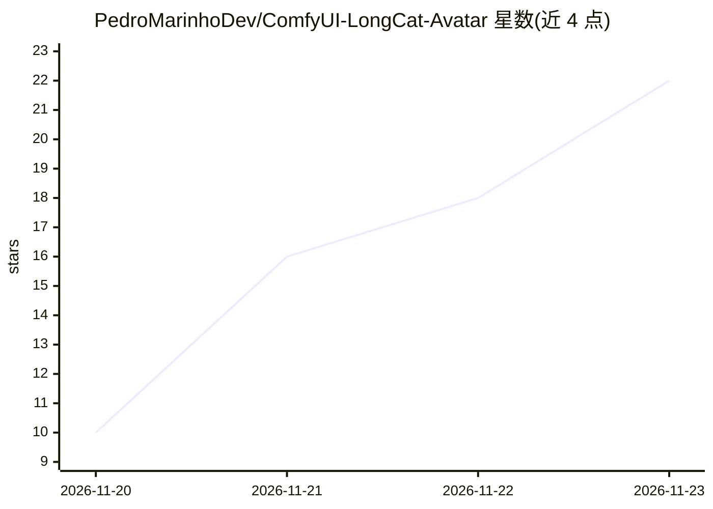

# PedroMarinhoDev/ComfyUI-LongCat-Avatar

⭐ 22 · Python · GPL-3.0 · 推送 2026-11-19 · [GitHub](https://github.com/PedroMarinhoDev/ComfyUI-LongCat-Avatar) · [官网](https://huggingface.co/PedroMarinhoDev/LongCat-Video-Avatar-1.6-ComfyUI) · 个人维护

**在 ComfyUI 原生运行 LongCat 数字人视频生成的节点包**

ComfyUI 自定义节点，接入美团 LongCat-Video-Avatar 1.6 模型：从起始图、提示词和语音生成说话视频，按 93 帧分段续接至语音结束。模型作为真正的 MODEL 接入 ComfyUI 自带的采样器、guider、LoRA 与显存管理；音频用 Whisper large-v3 编码，文本编码器与 VAE 与 Wan 2.1 完全一致可复用。提供 int8/W6A8/W4A8 量化文件与 8 步蒸馏 LoRA 路径。安装方式为 ComfyUI-Manager、comfy node install 或克隆仓库；语音需先分离人声，未移植双人生成等功能。

## 筛选速览

| 维度 | 判定 | 备注 |
|---|---|---|
| AI 角色 | `ai-native` | 本体是模型或模型工具 |
| 许可风险 | `viral` | GPL-3.0 |
| 部署形态 | `library` | 以包/库形式分发 |
| 模型依赖 | — | README 未给出锁定关系 |
| 硬件要求 | `gpu-24g` | |
| 安装摩擦 | `medium` | 含编译或系统依赖之一 |
| 成熟度 | — | 结构信号不足 |

## 能力要点

- 音频驱动的说话视频生成，长度随语音分段续接
- 原生接入 ComfyUI 采样器、LoRA 补丁与动态显存管理
- 提供 int8/W6A8/W4A8 量化与 8 步 DMD+OPSD 蒸馏 LoRA
- 分段即解码即编码到 mp4，长度只占磁盘不占内存

## 适用场景

- 从一张人像图和一段语音生成说话/唱歌视频
- 在 ComfyUI 工作流中生成数字人口型对齐视频
- 用量化模型在有限显存下生成长视频

## 场景标签

`视频生成` · 领域:内容生成

## 证据(README 行号)

> L13: **natively in ComfyUI**: audio-driven talking video from a start image, a prompt and speech, continued segment by
> L30:  Native ComfyUI ComfyUI's model, samplers, LoRA patches and dynamic VRAM; the base node's guidance is core's Dual C

## 星数曲线

2026-11-20 10 → 2026-11-23 22（+12）

---
*卡片 v1 · prompt 1.4 · 生成 2026-11-20 · 置信度 mid · 依据 README sha `f695332b300d` · [字段定义](../../DATASET.md)*
