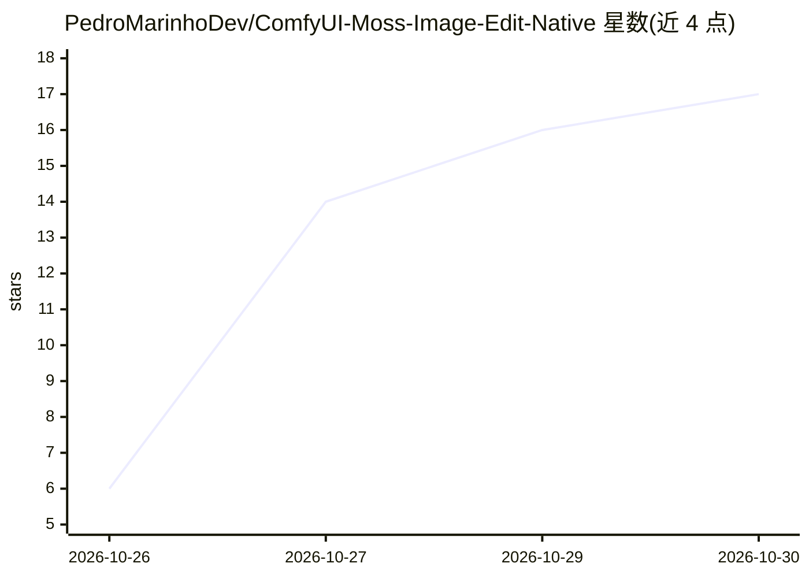

# PedroMarinhoDev/ComfyUI-Moss-Image-Edit-Native

⭐ 17 · Python · GPL-3.0 · 推送 2026-10-25 · [GitHub](https://github.com/PedroMarinhoDev/ComfyUI-Moss-Image-Edit-Native) · 个人维护

**ComfyUI 原生节点包：用文本指令编辑图像的 MOSS-Image 编辑 LoRA 集成**

面向 ComfyUI v0.42+ 用户的自定义节点包，将 MOSS-Image SFT 模型与三个社区编辑 LoRA（chinoll 版及 MOSS-Image-Edit-HQ v3/v5）以 ComfyUI 原生方式运行：使用官方 stock loaders、LoRA loader、采样器与显存管理（智能动态 VRAM、预取、部分 offload），不依赖 diffusers 与额外依赖。支持单图或最多四图组合编辑，随附六个示例工作流与推荐参数（来自 RTX 3090/4090 上 400 余次测试）。模型文件需自行下载放入对应目录。

## 筛选速览

| 维度 | 判定 | 备注 |
|---|---|---|
| AI 角色 | `ai-ecosystem` | LLM/agent 周边工具 |
| 许可风险 | `viral` | GPL-3.0 |
| 部署形态 | `None` |  |
| 模型依赖 | — | README 未给出锁定关系 |
| 硬件要求 | — | 无带数字的原话,不猜 |
| 安装摩擦 | `low` | 无编译、无系统依赖或容器化 |
| 成熟度 | — | 结构信号不足 |

## 能力要点

- 复用 ComfyUI 原生加载器、采样器与显存管理，无额外依赖
- 支持 chinoll 与 MOSS-Image-Edit-HQ v3/v5 三个编辑 LoRA，最多四图组合编辑
- 提供六个示例工作流与经 400 余次测试的推荐参数（LoRA 强度 1.0、CFG、SFT 模型等）
- 随附格式转换脚本 tools/convert_lora.py，校验 sha256 与张量形状

## 适用场景

- 在 ComfyUI 中按文本指令对图像做添加、删除、替换、改色等编辑
- 用两张图组合编辑（如把图 2 的服装穿到图 1 人物身上）
- 按 GEdit-Bench/ImgEdit 类别对照三个 LoRA 的编辑效果选择使用

## 场景标签

`图像生成` · 领域:内容生成

## 证据(README 行号)

> L1: ComfyUI-Moss-Image-Edit-Native: edit images with a text instruction on ComfyUI
> L18: LoRAs: chinoll's, and MOSS-Image-Edit-HQ v3 and v5. It uses ComfyUI's stock loaders, LoRA loader, samplers and memo

## 星数曲线

2026-10-26 6 → 2026-10-30 17（+11）

---
*卡片 v1 · prompt 1.4 · 生成 2026-10-30 · 置信度 high · 依据 README sha `686d2dacfc30` · [字段定义](../../DATASET.md)*
