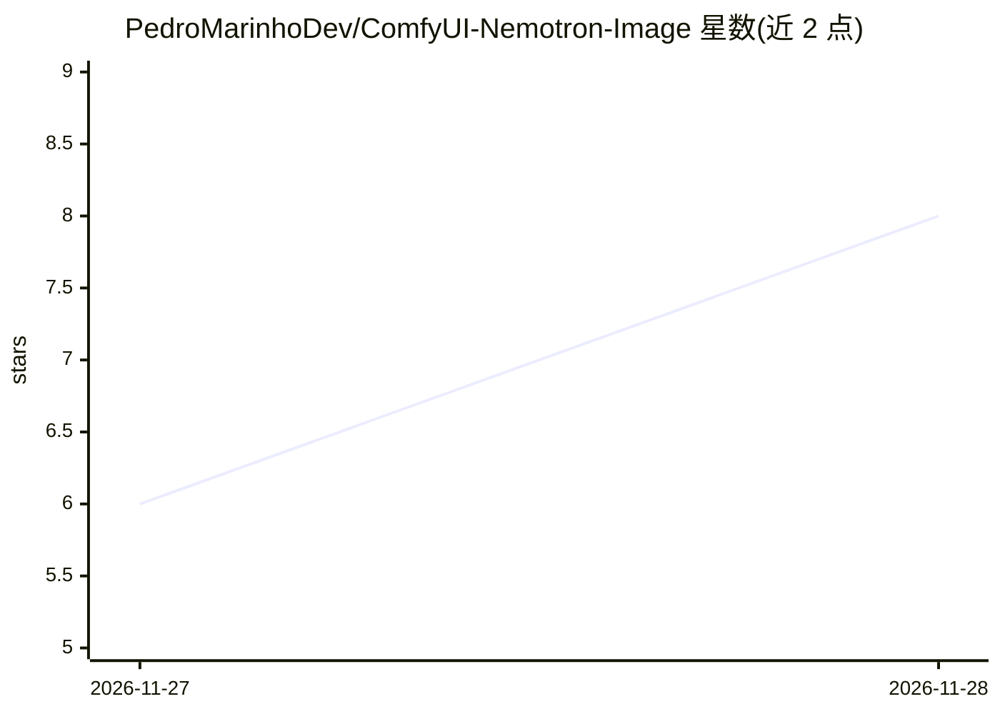

# PedroMarinhoDev/ComfyUI-Nemotron-Image

⭐ 8 · Python · GPL-3.0 · 推送 2026-11-25 · [GitHub](https://github.com/PedroMarinhoDev/ComfyUI-Nemotron-Image) · 个人维护

**在 ComfyUI 中原生运行 NVIDIA Nemotron-Labs-Image-30B-A3B 文生图**

一组 ComfyUI 自定义节点，将 NVIDIA Nemotron-Labs-Image-30B-A3B（30B MoE，每 token 激活 3B）接入 ComfyUI 工作流：该模型为自回归架构而非扩散模型，逐行写入 16×16 像素编码；节点以单个 Nemotron Image Generate 节点替代 KSampler 输出 LATENT，像素解码器以标准 VAE 节点加载。提供 5 种权重精度文件（W4A8 至 bf16），依赖专家缓存机制在 VRAM 与系统内存间调度。声明仅限研究与评估用途，无 pip 依赖，权重从 Hugging Face 下载。

## 筛选速览

| 维度 | 判定 | 备注 |
|---|---|---|
| AI 角色 | `ai-native` | 本体是模型或模型工具 |
| 许可风险 | `viral` | GPL-3.0 |
| 部署形态 | `library` | 以包/库形式分发 |
| 模型依赖 | — | README 未给出锁定关系 |
| 硬件要求 | `gpu-8g` | |
| 安装摩擦 | `medium` | 含编译或系统依赖之一 |
| 成熟度 | — | 结构信号不足 |

## 能力要点

- 自回归文生图：MoE 语言模型以 16×16 像素编码逐行写图
- 单节点替代 KSampler，输出 LATENT，像素解码走标准 VAE Decode
- 提供 W4A8/int8/W6A8/bf16 五种精度权重，附各文件显存/内存占用与速度表
- 在 RTX 3090/4090 上经 CUDA kernel 与专家缓存运行

## 适用场景

- 在 ComfyUI 工作流中做 Nemotron 图像模型的推理与评估
- 在 24GB 及以下显存显卡上按精度文件权衡质量与速度生成图像
- 测试自回归（非扩散）文生图流程的节点化集成

## 场景标签

`图像生成` `模型量化` · 领域:内容生成

## 证据(README 行号)

> L3: **ComfyUI-Nemotron-Image** runs NVIDIA's
> L4: Nemotron-Labs-Image-30B-A3B natively in ComfyUI.
> L6: - **Autoregressive, not diffusion.** A 30B mixture-of-experts language model (3B active per token) writes the image

## 星数曲线

2026-11-27 6 → 2026-11-28 8（+2）

---
*卡片 v1 · prompt 1.4 · 生成 2026-11-27 · 置信度 mid · 依据 README sha `50d94968ae59` · [字段定义](../../DATASET.md)*
