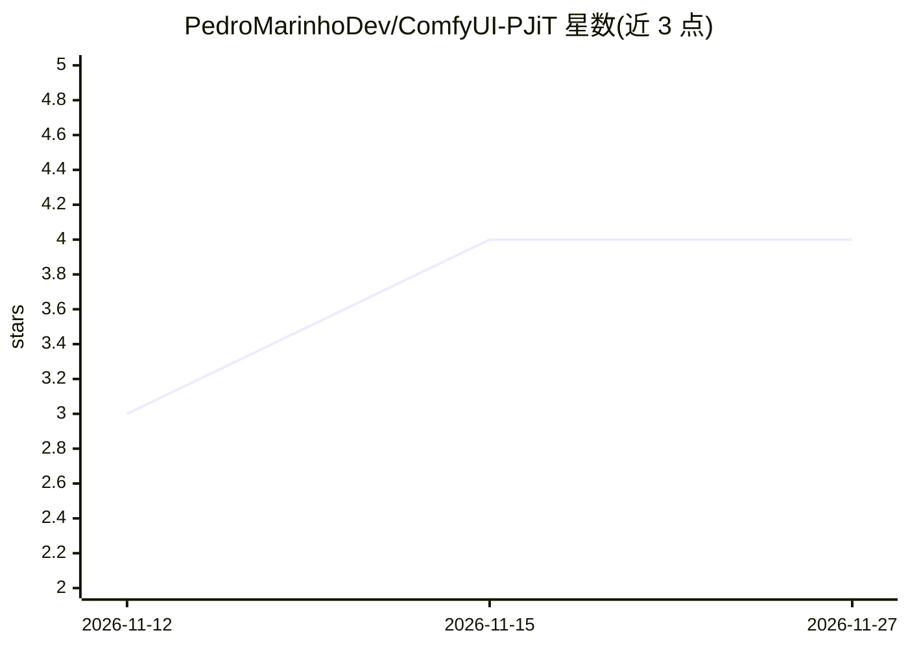

# PedroMarinhoDev/ComfyUI-PJiT

⭐ 4 · Python · GPL-3.0 · 推送 2026-11-05 · [GitHub](https://github.com/PedroMarinhoDev/ComfyUI-PJiT) · [官网](https://huggingface.co/PedroMarinhoDev/P-JiT-21K-ComfyUI) · 个人维护

**在 ComfyUI 中原生运行 Linum P-JiT 21K 像素空间文生图模型**

ComfyUI 自定义节点包，将 Linum 的 P-JiT 21K（2B 参数、无 VAE、直接在像素空间生成的文生图模型）接入 ComfyUI：模型注册为 `MODEL`、Qwen3.5-4B 文本编码器注册为 `CLIP`，使用 ComfyUI 自带的 KSampler 与动态显存管理，不改动 ComfyUI 本体。提供 bf16（4.37 GB）与 int8 ConvRot（2.33 GB）模型文件及四种文本编码器量化档位，附四个示例工作流（文生图、提示词扩写、图生图精修、复现 Linum 样例）。通过 git clone 安装到 custom_nodes，无需额外 pip 依赖；限制包括无法绘制文字/标志、全屏提示词需 50-80 词密集描述。

## 筛选速览

| 维度 | 判定 | 备注 |
|---|---|---|
| AI 角色 | `ai-native` | 本体是模型或模型工具 |
| 许可风险 | `viral` | GPL-3.0 |
| 部署形态 | `library` | 以包/库形式分发 |
| 模型依赖 | — | README 未给出锁定关系 |
| 硬件要求 | `gpu-8g` | |
| 安装摩擦 | `low` | 无编译、无系统依赖或容器化 |
| 成熟度 | — | 结构信号不足 |

## 能力要点

- 像素空间直接生成，无 VAE，实时预览即图像本身
- bf16 文件输出与 fp32 逐像素一致（README 报告验证数据），int8 ConvRot 约 1.8x 提速
- 动态显存下 4 GB 空闲 VRAM 可运行，文本编码器可切到 CPU
- 提示词扩写支持 local（本地 Qwen3.5-4B，无需 API key）与 openrouter 两种后端

## 适用场景

- 在 ComfyUI 中直接用 KSampler 跑 P-JiT 文生图
- 用精修工作流对其他模型（如 FLUX.2）的输出做二次低重绘去噪
- 在低显存（4 GB 起）环境下生成分辨率至 1280×720 的图像
- 复现 Linum 已发布样例图（相同种子与噪声）

## 场景标签

`图像生成` `模型量化` · 领域:内容生成

## 证据(README 行号)

> L13: Run **P-JiT 21K** by Linum **natively in ComfyUI**. P-JiT is a 2B-parameter
> L15: of compute and calls it a research checkpoint with rough edges. Here it is a real `MODEL` on ComfyUI's memory manag
> L181: |Node|What it does|

## 星数曲线

2026-11-12 3 → 2026-11-27 4（+1）

---
*卡片 v1 · prompt 1.4 · 生成 2026-11-26 · 置信度 mid · 依据 README sha `20cffa394667` · [字段定义](../../DATASET.md)*
