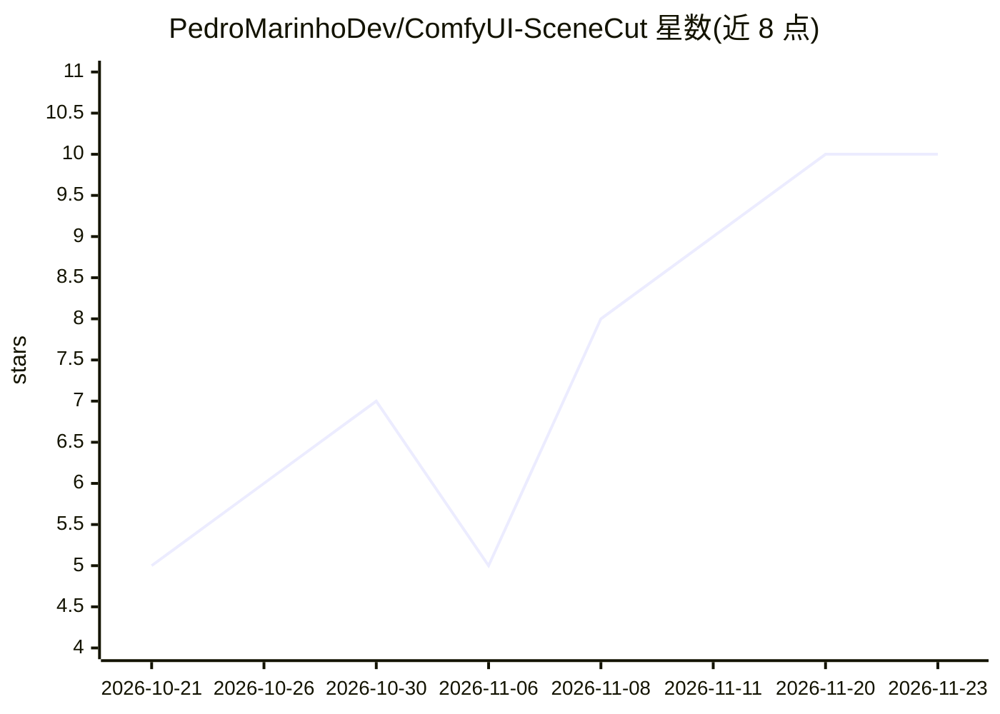

# PedroMarinhoDev/ComfyUI-SceneCut

⭐ 10 · Python · MIT · 推送 2026-10-25 · [GitHub](https://github.com/PedroMarinhoDev/ComfyUI-SceneCut) · [官网](https://pedromarinhodev.github.io/ComfyUI-SceneCut/) · 个人维护

**ComfyUI 视频镜头切分节点：检测切点、人工修正并导出片段**

以 ComfyUI 自定义节点形式提供的视频镜头切分（shot cut detection）工具链：OmniShotCut 模型检测切点并标注转场类型，DINOv3 嵌入校验避免闪光/快速摇镜导致的误切；内置查看器支持逐帧播放、一键修正切点、选取场景并按精确帧导出带音频的片段（H.264/H.265/NVENC/ProRes/FFV1）及 scenes.json。模型首次使用时自动下载并做 SHA-256 校验；提供无 ComfyUI 依赖的 headless 运行方式。

## 筛选速览

| 维度 | 判定 | 备注 |
|---|---|---|
| AI 角色 | `ai-native` | 本体是模型或模型工具 |
| 许可风险 | `permissive` | MIT |
| 部署形态 | `library` | 以包/库形式分发 |
| 模型依赖 | — | README 未给出锁定关系 |
| 硬件要求 | — | 无带数字的原话,不猜 |
| 安装摩擦 | `medium` | 含编译或系统依赖之一 |
| 成熟度 | — | 结构信号不足 |

## 能力要点

- OmniShotCut 检测 + DINOv3 嵌入校验，切点帧级精确
- 节点内查看器：逐帧检查、Fix cut 一键修正、场景选择
- 按场景导出片段与 scenes.json，支持多种编码（含 NVENC/ProRes/FFV1）
- scenecut 包无 ComfyUI 依赖，可脚本调用

## 适用场景

- 把长视频按镜头切分成片段用于训练数据集
- 影视/动漫/Vlog 等素材按预设检测镜头并挑选导出
- 在 ComfyUI 工作流中将场景列表接入下游节点处理

## 场景标签

`图像视频处理` `目标检测` · 领域:感知与多模态

## 证据(README 行号)

> L12: Find every shot in a video, **natively in ComfyUI**: **OmniShotCut**
> L13: finds the cuts and labels the transitions, **DINOv3** checks every cut so a camera flash or a whip pan doesn't spli
> L126: |**SceneCut Detect**|`VIDEO` + preset (+ validate, device) → scene list, shot count, summary|

## 星数曲线

2026-10-21 5 → 2026-11-23 10（+5）

---
*卡片 v1 · prompt 1.4 · 生成 2026-11-20 · 置信度 mid · 依据 README sha `11e861b9702b` · [字段定义](../../DATASET.md)*
