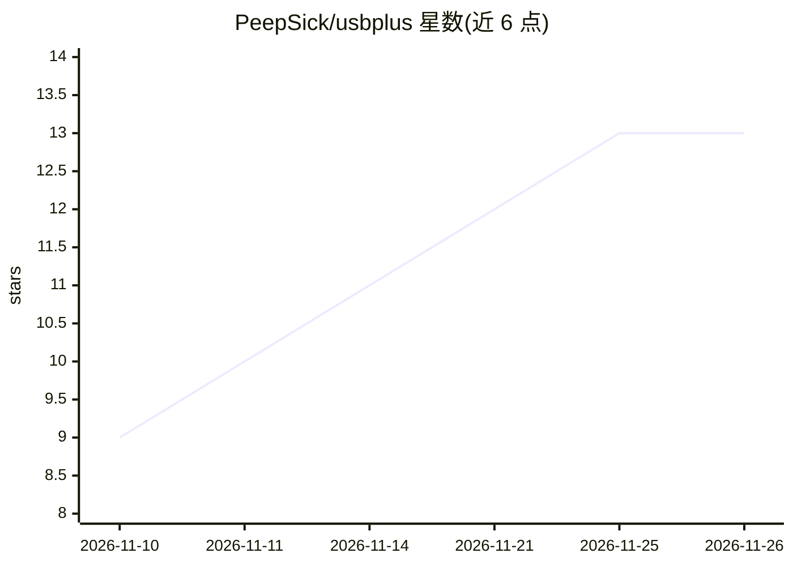

# PeepSick/usbplus

⭐ 13 · Python · MIT · 推送 2026-11-24 · [GitHub](https://github.com/PeepSick/usbplus) · [官网](https://usbplus.peepsicklabs.com) · 组织维护

**面向 agent 生态的技能安装与信任校验 CLI**

USB 是一个面向 AI agent 能力的目录与信任层工具：通过 CLI 在仓库中发现 skill、MCP server、agent 定义与命令，统一转换为 16 种运行时目标格式（如 SKILL.md、.mdc 规则）并安装；Trust Layer 提供 secscan 静态比对声明与实际能力、mcprobe 观测 MCP server 启动行为、verify/lock/diff/repair 做 SHA-256 完整性校验，输出确定性判定与 CI 退出码。npm 全局安装，零依赖。

## 筛选速览

| 维度 | 判定 | 备注 |
|---|---|---|
| AI 角色 | `ai-ecosystem` | LLM/agent 周边工具 |
| 许可风险 | `permissive` | MIT |
| 部署形态 | `self-host` | docker 或自建部署 |
| 模型依赖 | — | README 未给出锁定关系 |
| 硬件要求 | — | 无带数字的原话,不猜 |
| 安装摩擦 | `low` | 无编译、无系统依赖或容器化 |
| 成熟度 | — | 结构信号不足 |

## 能力要点

- 一个 skill 格式输出到 16 种运行时目标（4 种原生安装 + 11 种便携包）
- secscan 静态契约校验：声明能力 vs 观测能力，同一输入产生字节一致报告
- mcprobe 在获得同意下观测 MCP server 启动，从不调用工具
- verify/lock/diff/repair 基于本地 SHA-256 实现防篡改完整性检查

## 适用场景

- 安装第三方 skill 前检查其是否存在未声明的凭据访问、管道到 shell 等能力
- 在 CI 中用 secscan 退出码与基线机制门禁第三方技能集合
- 将同一套技能安装到 Claude Code、Cursor 等多个运行时

## 场景标签

`网络安全` · 领域:学习与行业

## 证据(README 行号)

> L3: USB is an open-source trust layer for AI capabilities.
> L47: `usb install` bridges your machine to the catalog: it detects installed AI runtimes and installs natively where it 

## 星数曲线

2026-11-10 9 → 2026-11-26 13（+4）

---
*卡片 v1 · prompt 1.4 · 生成 2026-11-18 · 置信度 high · 依据 README sha `e9dcc8fc59f4` · [字段定义](../../DATASET.md)*
