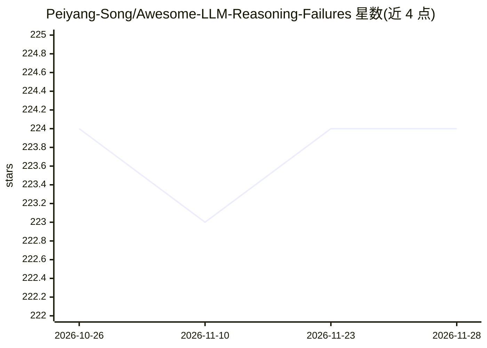

# Peiyang-Song/Awesome-LLM-Reasoning-Failures

⭐ 224 · MIT · 推送 2026-11-23 · [GitHub](https://github.com/Peiyang-Song/Awesome-LLM-Reasoning-Failures) · 个人维护

**LLM 推理失败研究论文策展清单（配套 TMLR 综述）**

围绕论文《Large Language Model Reasoning Failures》（TMLR 2026，获 Survey Certification）维护的论文清单，收录 LLM 推理失败的发现、分析与缓解相关文献。按非形式推理（认知技能与偏差、社会推理）、形式推理（逻辑与算术）、具身环境推理（1D 文本/2D 感知/3D 真实世界）及逐案失败研究等类别组织，每个条目附会议/期刊信息、arXiv 链接与作者列表，并提供 BibTeX 引用信息。

## 筛选速览

| 维度 | 判定 | 备注 |
|---|---|---|
| AI 角色 | `ai-knowledge` | 知识聚合/清单类 |
| 许可风险 | `permissive` | MIT |
| 部署形态 | `None` |  |
| 模型依赖 | — | README 未给出锁定关系 |
| 硬件要求 | — | 无带数字的原话,不猜 |
| 安装摩擦 | `low` | 无编译、无系统依赖或容器化 |
| 成熟度 | — | 结构信号不足 |

## 能力要点

- 按认知偏差、形式推理、具身推理等类别组织论文条目
- 配套 TMLR 2026 综述论文并附 BibTeX 引用
- 每条论文附会议/期刊标签与论文链接
- 收录相关综述与基准（如多智能体失败、REFUTE）

## 适用场景

- 调研 LLM 推理失败与认知偏差相关文献
- 为推理评测基准的设计寻找已有研究
- 撰写 LLM 可靠性方向的论文时查找引用

## 场景标签

`精选清单` · 领域:学习与行业

## 证据(README 行号)

> L8:  A curated list of papers on discovery, analysis, and mitigation of LLM reasoning failures.
> L9:  This repository accompanies the paper "Large Language Model Reasoning Failures" ( TMLR 2026 Survey Certification ).

## 星数曲线

2026-10-26 224 → 2026-11-28 224（+0）

---
*卡片 v1 · prompt 1.4 · 生成 2026-11-25 · 置信度 high · 依据 README sha `fffb3e525335` · [字段定义](../../DATASET.md)*
