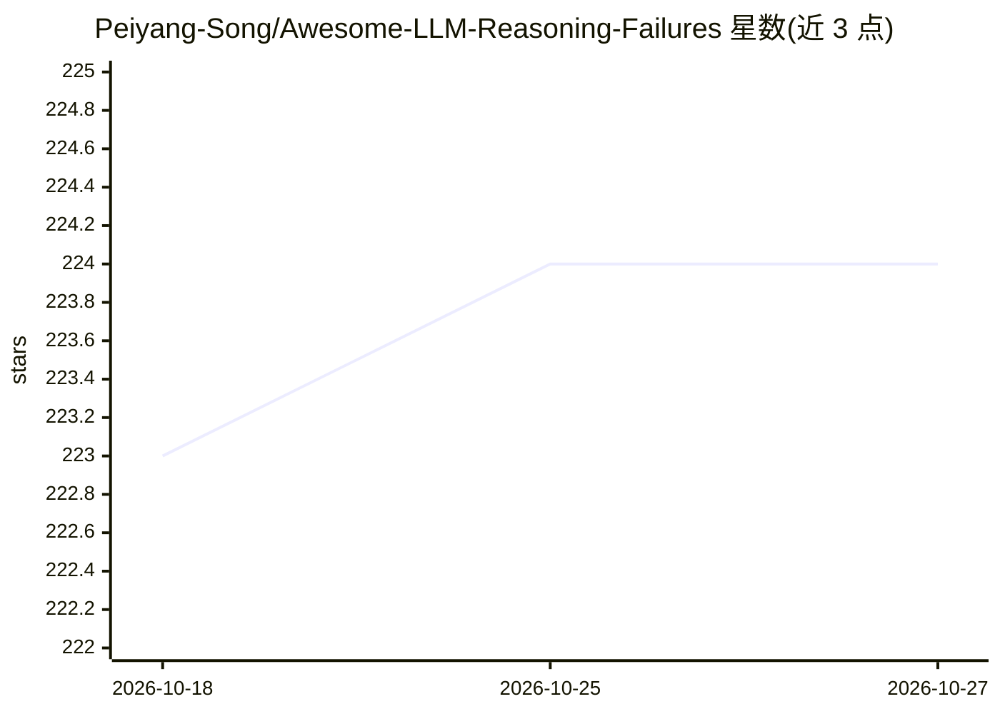

# Peiyang-Song/Awesome-LLM-Reasoning-Failures

⭐ 224 · MIT · 推送 2026-10-25 · [GitHub](https://github.com/Peiyang-Song/Awesome-LLM-Reasoning-Failures) · 个人维护

**LLM 推理失败研究论文策展清单**

伴随 TMLR 2026 综述论文《Large Language Model Reasoning Failures》维护的论文清单，收录关于 LLM 推理失败的发现、分析与缓解的论文。按非形式推理（个体认知技能与偏差、隐式/显式社会推理）、形式推理（自然语言逻辑、基准逻辑、算术数学）、具身环境推理（1D 文本/2D 感知/3D 真实世界）及通用个案研究分类组织，条目含论文标题、发表 venue 与链接。仓库本身不含代码，仅提供文献索引与引用信息。

## 筛选速览

| 维度 | 判定 | 备注 |
|---|---|---|
| AI 角色 | `ai-knowledge` | 知识聚合/清单类 |
| 许可风险 | `permissive` | MIT |
| 部署形态 | `None` |  |
| 模型依赖 | — | README 未给出锁定关系 |
| 硬件要求 | — | 无带数字的原话,不猜 |
| 安装摩擦 | `low` | 无编译、无系统依赖或容器化 |
| 成熟度 | — | 结构信号不足 |

## 能力要点

- 按非形式/形式/具身等类别组织的论文分类目录
- 覆盖工作记忆、确认偏差、锚定效应、顺序敏感性等认知偏差研究
- 每条条目提供论文标题、发表 venue（AAAI/EMNLP/NeurIPS 等）与链接
- 附 TMLR 2026 综述论文本身的引用条目与 BibTeX

## 适用场景

- 研究者查找 LLM 推理失败与认知偏差相关文献
- 按推理类型（逻辑/算术/具身/社会）定位特定失败模式的研究
- 为综述写作或失败分析研究收集参考文献

## 场景标签

`精选清单` `科研工具` · 领域:学习与行业

## 证据(README 行号)

> L8:  A curated list of papers on discovery, analysis, and mitigation of LLM reasoning failures.
> L9:  This repository accompanies the paper "Large Language Model Reasoning Failures" ( TMLR 2026 Survey Certification ).

## 星数曲线

2026-10-18 223 → 2026-10-27 224（+1）

---
*卡片 v1 · prompt 1.4 · 生成 2026-10-22 · 置信度 high · 依据 README sha `59a849ae4576` · [字段定义](../../DATASET.md)*
