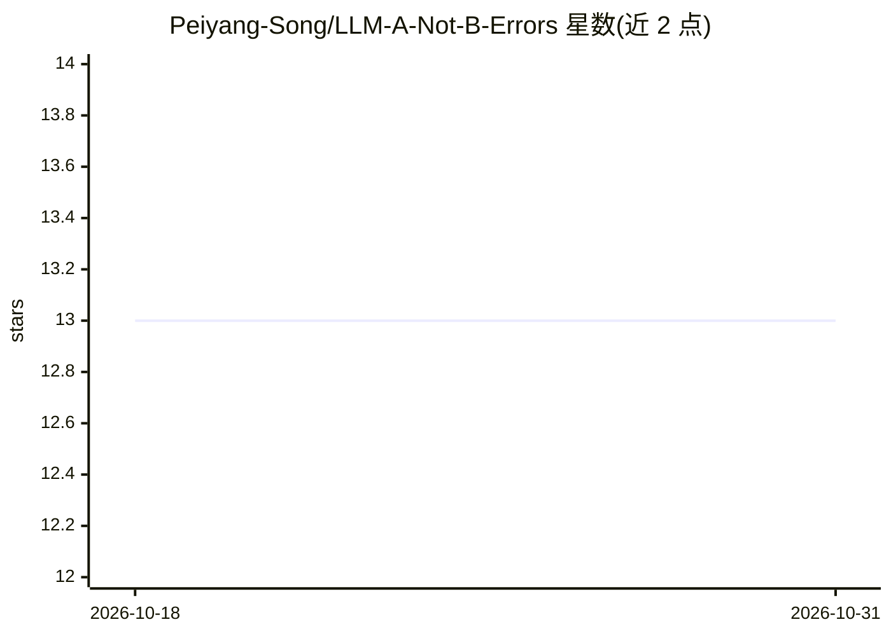

# Peiyang-Song/LLM-A-Not-B-Errors

⭐ 13 · Python · MIT · 推送 2026-01-10 · [GitHub](https://github.com/Peiyang-Song/LLM-A-Not-B-Errors) · 组织维护

**EMNLP 2024 论文官方代码：研究预训练模型的 A-Not-B 错误**

论文 In-Context Learning May Not Elicit Trustworthy Reasoning: A-Not-B Errors in Pretrained Language Models（Findings of EMNLP 2024）的官方开源仓库，MIT 许可。提供四个推理任务的处理与二值化数据、主实验代码 A_not_B.py 及两项后续实验（自我解释、额外选项）脚本，并附可复用于自有数据集的数据处理工具。代码安装 requirements.txt 中少量 pip 包后可直接运行，供复现实验与扩展研究的科研人员使用。

## 筛选速览

| 维度 | 判定 | 备注 |
|---|---|---|
| AI 角色 | `ai-knowledge` | 知识聚合/清单类 |
| 许可风险 | `permissive` | MIT |
| 部署形态 | `None` |  |
| 模型依赖 | — | README 未给出锁定关系 |
| 硬件要求 | — | 无带数字的原话,不猜 |
| 安装摩擦 | `low` | 无编译、无系统依赖或容器化 |
| 成熟度 | — | 结构信号不足 |

## 能力要点

- 四个推理任务的处理与二值化数据
- 主实验与两项后续实验（自我解释、额外选项）代码
- 数据处理脚本可复用于自有数据集
- MIT 许可，代码可直接运行

## 适用场景

- 复现论文中的 A-Not-B 错误实验
- 在更多推理任务或模型上扩展 A-Not-B 研究
- 检查自我解释与额外选项能否缓解该错误

## 场景标签

`科研工具` `模型评测` · 领域:评测与运维

## 证据(README 行号)

> L3: 🚩**News**: Our work is accepted to the Findings of Empirical Methods in Natural Language Processing (EMNLP) 2024. Se
> L7: This official repository holds code for the paper "**In-Context Learning May Not Elicit Trustworthy Reasoning: A-Not

## 星数曲线

2026-10-18 13 → 2026-10-31 13（+0）

---
*卡片 v1 · prompt 1.4 · 生成 2026-10-31 · 置信度 high · 依据 README sha `5f786b601182` · [字段定义](../../DATASET.md)*
