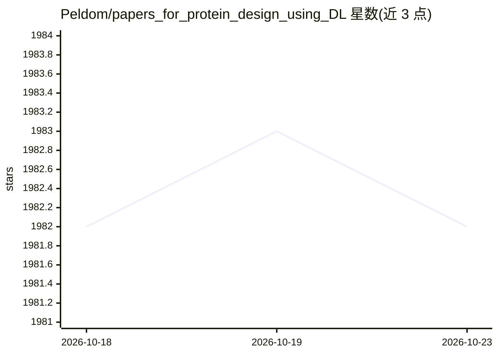

# Peldom/papers_for_protein_design_using_DL

⭐ 1,982 · GPL-3.0 · 推送 2026-08-15 · [GitHub](https://github.com/Peldom/papers_for_protein_design_using_DL) · 个人维护

**深度学习蛋白质设计论文清单，按任务与模型分类**

聚焦蛋白质设计×深度学习方向的论文聚合清单，受 Machine-learning-for-proteins 项目启发建立。内容按 8 个大类组织：基准与数据集、综述、基于模型的设计、Function-to-Scaffold、Scaffold-to-Sequence、Function-to-Sequence、Function-to-Structure 等，大类下再按 GAN/Diffusion/Transformer/RL 等模型方法细分；条目含论文标题、作者、出处及部分 code/dataset 链接。每周更新最新论文（README 显示更新至 2026.08.02），接受社区贡献。

## 筛选速览

| 维度 | 判定 | 备注 |
|---|---|---|
| AI 角色 | `ai-knowledge` | 知识聚合/清单类 |
| 许可风险 | `viral` | GPL-3.0 |
| 部署形态 | `None` |  |
| 模型依赖 | — | README 未给出锁定关系 |
| 硬件要求 | — | 无带数字的原话,不猜 |
| 安装摩擦 | `low` | 无编译、无系统依赖或容器化 |
| 成熟度 | — | 结构信号不足 |

## 能力要点

- 按 8 大任务类别组织论文，细至 20 余种模型方法子类
- 覆盖序列/结构数据集与基准（ProteinGym、ProteinBench、PDBench 等）
- 每周追踪新论文，条目附 code/dataset 链接
- 含 AI 安全相关条目（AI 驱动蛋白质设计风险的实验评估）

## 适用场景

- 查找蛋白质设计各任务方向的代表论文与基准
- 按模型方法（扩散、LLM、RL 等）检索相关工作
- 为科研选题综述收集数据集与评测资源

## 场景标签

`精选清单` `科研工具` · 领域:学习与行业

## 证据(README 行号)

> L1: # List of papers about Protein Design using Deep Learning
> L16:  0) Benchmarks and datasets
> L24:  1) Reviews and surveys

## 星数曲线

2026-10-18 1,982 → 2026-10-23 1,982（+0）

---
*卡片 v1 · prompt 1.4 · 生成 2026-10-21 · 置信度 high · 依据 README sha `b2ee8cfe3d91` · [字段定义](../../DATASET.md)*
