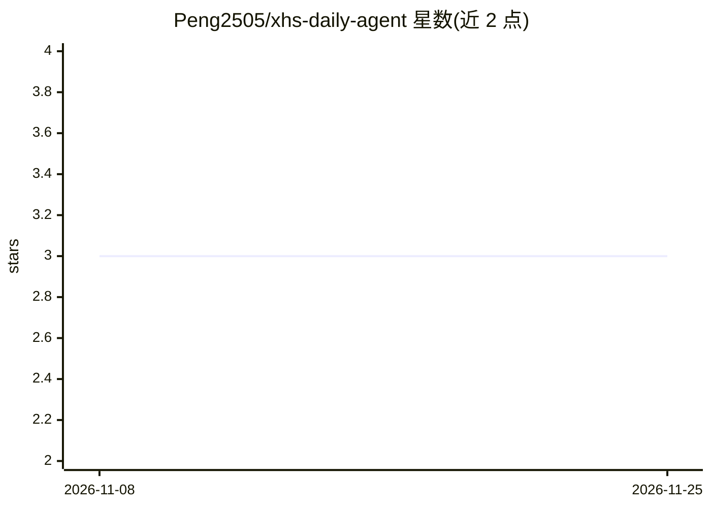

# Peng2505/xhs-daily-agent

⭐ 3 · HTML · 推送 2026-11-22 · [GitHub](https://github.com/Peng2505/xhs-daily-agent) · 个人维护 · 中文 README

**无人值守驱动无 API 站点发布笔记的 Agent 工程实践**

每天定时唤醒 Agent，走检索、逐条核实、成稿、排版出图、上传、发布、验收全链路，向小红书发布图文笔记，全程无人工介入。因目标平台无开放发布 API，采用独立 user-data-dir 与 CDP 远程调试端口驱动常驻 Edge 实例的方案，并记录三级降级点击、三判据验收、幂等校验、fail-closed 草稿保存等可靠性机制与 20 条失败模式。运行脚本仅依赖 websockets，约 100 行同步 CDP 客户端，不依赖 Playwright/Selenium 与 Agent 框架；登录态需人工维护。

## 筛选速览

| 维度 | 判定 | 备注 |
|---|---|---|
| AI 角色 | `ai-native` | 本体是模型或模型工具 |
| 许可风险 | `none` | — |
| 部署形态 | `library` | 以包/库形式分发 |
| 模型依赖 | — | README 未给出锁定关系 |
| 硬件要求 | — | 无带数字的原话,不猜 |
| 安装摩擦 | `low` | 无编译、无系统依赖或容器化 |
| 成熟度 | `idea` | |

## 能力要点

- CDP 驱动常驻 Edge 实例，登录态跨天保留
- 三级降级点击：坐标点击→AX 树定位→运行时直调
- 发布前幂等校验与 fail-closed 草稿保存机制
- 20 条完整失败模式记录于 docs/failure-modes.md

## 适用场景

- 研究无开放 API 站点上的 Agent 工程化方法
- 定时自动向无 API 平台发布图文内容
- 参考浏览器自动化降级与验收的设计

## 场景标签

`浏览器自动化` `Agent 框架` `图像生成` · 领域:Agent 开发

## 证据(README 行号)

> L4: 每天定时唤醒一个 Agent，走完 **检索 → 逐条核实 → 成稿 → 排版出图 → 上传 → 发布 → 验收** 全链路，把一条图文笔记发到小红书上，全程无人工介入。
> L46: |**独立 user-data-dir + `--remote-debugging-port`** ✅|独立 profile 不与日常浏览器抢锁，登录态跨天保留；Agent 通过 CDP 直接驱动这个常驻实例|

## 星数曲线

2026-11-08 3 → 2026-11-25 3（+0）

---
*卡片 v1 · prompt 1.4 · 生成 2026-11-22 · 置信度 high · 依据 README sha `811e6f003a3a` · [字段定义](../../DATASET.md)*
