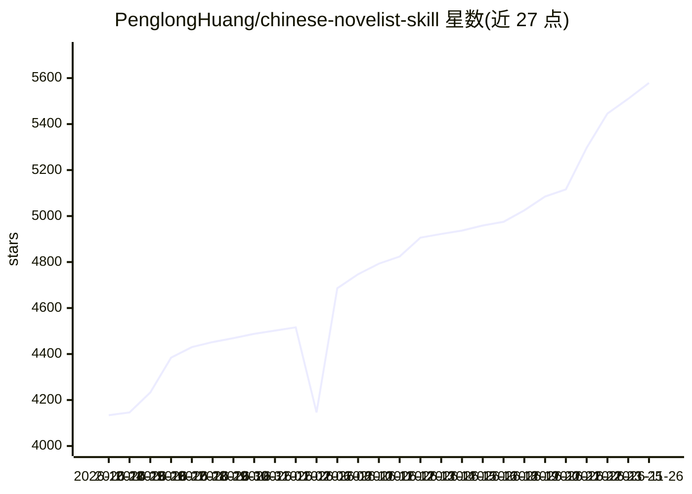

# PenglongHuang/chinese-novelist-skill

⭐ 5,579 · JavaScript · MIT · 推送 2026-11-25 · [GitHub](https://github.com/PenglongHuang/chinese-novelist-skill) · 个人维护 · 中文 README

**让 AI Agent 从零生成 10-50 章中文小说的 Skill**

一个面向 Coding Agent / Personal Agent 的中文长篇小说创作技能包：通过三层递进式问答收集题材、视角与文风，确认规划后以串行、子 Agent 并行或 Agent Teams 三种模式逐章生成 10-50 章内容；内置偏好记忆（跨项目共享）、中断检测续写、逐章审读与字数校验修复，并附带本地"小说书房"界面浏览书架、正文与审读报告。以 Skill 形式经 npm 安装，适配多种主流 Agent Harness。

## 筛选速览

| 维度 | 判定 | 备注 |
|---|---|---|
| AI 角色 | `ai-native` | 本体是模型或模型工具 |
| 许可风险 | `permissive` | MIT |
| 部署形态 | `library` | 以包/库形式分发 |
| 模型依赖 | — | README 未给出锁定关系 |
| 硬件要求 | — | 无带数字的原话,不猜 |
| 安装摩擦 | `low` | 无编译、无系统依赖或容器化 |
| 成熟度 | — | 结构信号不足 |

## 能力要点

- 三层递进式问答与规划确认流程，支持跳过与随机生成
- 偏好记忆系统：自动学习题材、叙事风格、章节偏好
- 中断续写检测与逐章审读、字数校验修复
- 本地"小说书房"界面随文件变化实时刷新

## 适用场景

- 让 AI 帮我从人物大纲开始写到一部完整中文小说
- 长篇网文连载需要章节衔接和悬念管理
- 想换个模型对比同一大纲的文笔表现

## 场景标签

`AI 写作` · 领域:内容生成

## 证据(README 行号)

> L3: ### 让 AI 为你写一部完整的中文小说
> L15: 脑子里有个故事，却总卡在“然后呢”？先定人物和大纲，再逐章写到完稿。面向 Coding Agent、Personal Agent 等各类 Agent：

## 星数曲线

2026-10-24 4,134 → 2026-11-26 5,579（+1,445）

---
*卡片 v1 · prompt 1.4 · 生成 2026-11-26 · 置信度 high · 依据 README sha `c1dd62c0e89e` · [字段定义](../../DATASET.md)*
