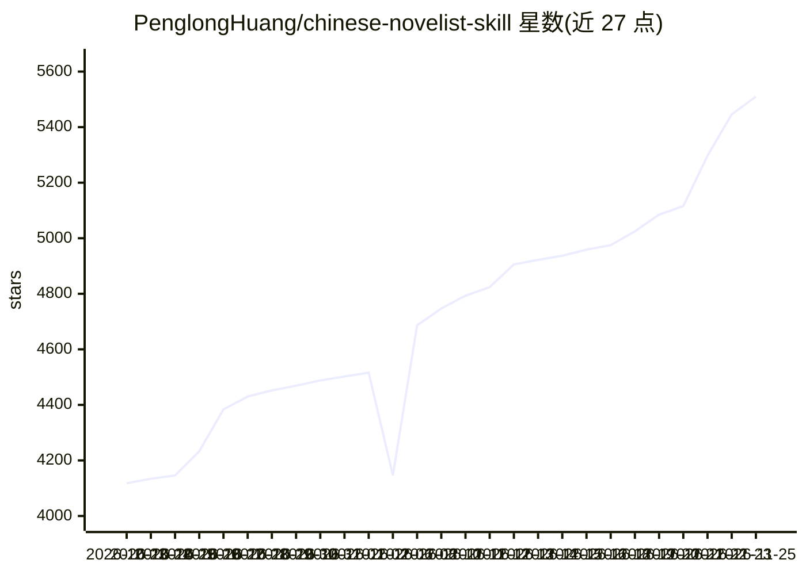

# PenglongHuang/chinese-novelist-skill

⭐ 5,510 · JavaScript · MIT · 推送 2026-11-15 · [GitHub](https://github.com/PenglongHuang/chinese-novelist-skill) · 个人维护 · 中文 README

**让 coding agent 从零写完整中文长篇小说的 Skill**

一个面向 Claude Code 等 coding agent 的技能包：通过四阶段流程（初始化→三层问答→规划确认→连续写作→自动校验）生成 10-50 章的中文小说。内置偏好记忆（user-preferences.json 跨项目共享）、中断续写、串行/子Agent并行/Agent Teams 三种写作模式，每章 3000-5000 字并经润色与字数校验（不合格自动修复最多 3 轮）。附带流程文档与 10 份写作指南（悬念钩子、对话、情节结构等模板）。通过 npx skills add 安装，MIT 许可。

## 筛选速览

| 维度 | 判定 | 备注 |
|---|---|---|
| AI 角色 | `ai-native` | 本体是模型或模型工具 |
| 许可风险 | `permissive` | MIT |
| 部署形态 | `library` | 以包/库形式分发 |
| 模型依赖 | — | README 未给出锁定关系 |
| 硬件要求 | — | 无带数字的原话,不猜 |
| 安装摩擦 | `low` | 无编译、无系统依赖或容器化 |
| 成熟度 | — | 结构信号不足 |

## 能力要点

- 四阶段流程生成 10-50 章中文小说，每章 3000-5000 字
- 三层递进式问答与偏好记忆，支持跳过/随机生成/默认值
- 三种写作模式：串行、子Agent 并行、Agent Teams
- 中断续写与自动字数校验（不合格章节最多修复 3 轮）

## 适用场景

- 从题材创意开始让 AI 逐章写完一部长篇网文
- 意外中断后从已保存进度继续连载
- 复用个人文风与题材偏好，省去重复问答

## 场景标签

`AI 写作` · 领域:内容生成

## 证据(README 行号)

> L3: ### 让 AI 为你写一部完整的中文小说
> L6: Claude Code Skill
> L90: AI 生成人物档案、章节大纲和写作计划，展示给你确认：

## 星数曲线

2026-10-23 4,118 → 2026-11-25 5,510（+1,392）

---
*卡片 v1 · prompt 1.4 · 生成 2026-11-23 · 置信度 high · 依据 README sha `bb7ee762366b` · [字段定义](../../DATASET.md)*
