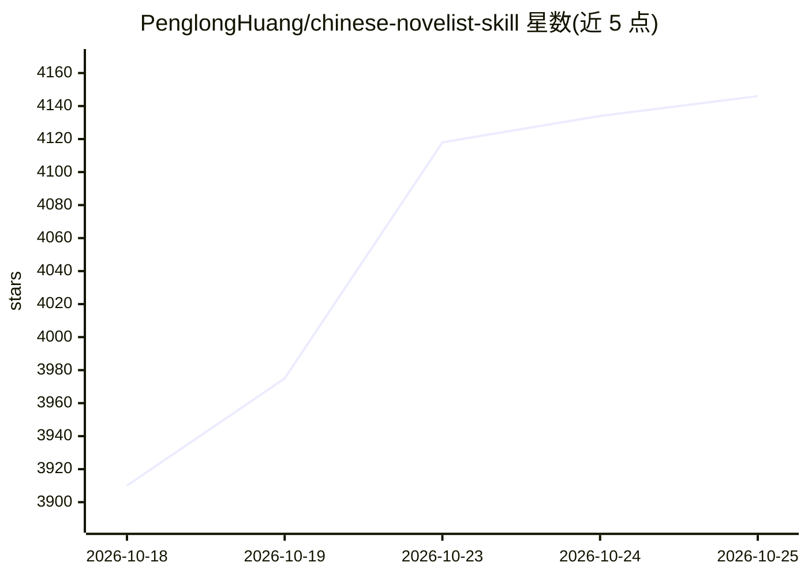

# PenglongHuang/chinese-novelist-skill

⭐ 4,146 · Python · MIT · 推送 2026-10-20 · [GitHub](https://github.com/PenglongHuang/chinese-novelist-skill) · 个人维护 · 中文 README

**让 Claude Code 生成 10-50 章完整中文小说的技能包**

面向 Claude Code 等 coding agent 的中文长篇小说创作 SKILL：通过三层递进式问答（核心定位 3 问 + 深度定制 5 问）收集设定，生成 7 列章节大纲与人物档案，随后全自动逐章撰写 3000-5000 字并执行字数与连贯性校验，不合格章节自动重写最多 3 轮。支持串行/子Agent并行/Agent Teams 三种写作模式、跨会话偏好记忆、中断续写检测。以 npx skills 命令或手动放入 skills 目录安装，依赖宿主 agent 环境运行。

## 筛选速览

| 维度 | 判定 | 备注 |
|---|---|---|
| AI 角色 | `ai-native` | 本体是模型或模型工具 |
| 许可风险 | `permissive` | MIT |
| 部署形态 | `library` | 以包/库形式分发 |
| 模型依赖 | locked-api |  |
| 硬件要求 | — | 无带数字的原话,不猜 |
| 安装摩擦 | `low` | 无编译、无系统依赖或容器化 |
| 成熟度 | — | 结构信号不足 |

## 能力要点

- 三层递进式问答，支持随机生成与跳过
- 串行/子Agent并行/Agent Teams 三种写作模式
- 每章 3000-5000 字，字数与连贯性自动校验，不合格自动重写最多 3 轮
- 跨会话偏好记忆与中断续写检测

## 适用场景

- 让 AI 帮我从零写一部完整的长篇中文网文
- 题材不确定时通过递进问答逐步确定设定
- 意外中断后从断点继续未完成的小说项目

## 场景标签

`AI 写作` `提示工程` · 领域:Agent 开发

## 证据(README 行号)

> L3: ### 让 AI 为你写一部完整的中文小说
> L6: Claude Code Skill
> L144: 将此目录放入 Claude Code 的 skills 目录：

## 星数曲线

2026-10-18 3,910 → 2026-10-25 4,146（+236）

---
*卡片 v1 · prompt 1.4 · 生成 2026-10-20 · 置信度 high · 依据 README sha `67d397ec6854` · [字段定义](../../DATASET.md)*
