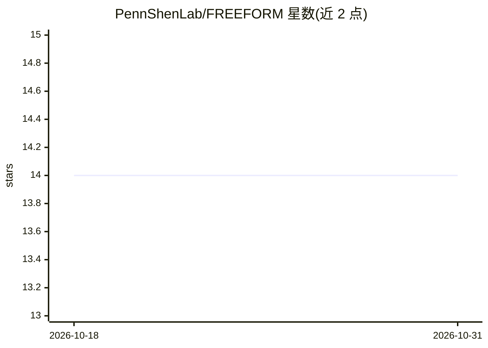

# PennShenLab/FREEFORM

⭐ 14 · Jupyter Notebook · 推送 2026-02-16 · [GitHub](https://github.com/PennShenLab/FREEFORM) · 组织维护

**用 LLM 知识做基因型数据特征选择与工程的研究框架**

论文官方代码库，实现 FREEFORM 框架：基于预训练 LLM 的内在知识，以链式推理与集成原则对表格型基因型数据做特征选择与特征工程，用于复杂遗传基础表型预测。在遗传血统与遗传性听力损失两个基因型-表型数据集上评估，论文称在低样本场景下优于多个数据驱动方法。以 Python 实现，提供 conda 环境文件、示例 notebook 与评估 notebook，核心函数位于 utils*.py。由宾夕法尼亚大学团队维护，NIH 资助。

## 筛选速览

| 维度 | 判定 | 备注 |
|---|---|---|
| AI 角色 | `ai-native` | 本体是模型或模型工具 |
| 许可风险 | `none` | — |
| 部署形态 | `None` |  |
| 模型依赖 | — | README 未给出锁定关系 |
| 硬件要求 | — | 无带数字的原话,不猜 |
| 安装摩擦 | `low` | 无编译、无系统依赖或容器化 |
| 成熟度 | — | 结构信号不足 |

## 能力要点

- 基于 LLM 内在知识的特征选择与特征工程
- 链式推理与集成设计
- 在两个基因型-表型数据集（遗传血统、遗传性听力损失）上评估
- 提供 demonstration 与 evaluation notebook 复现流程

## 适用场景

- 我想用 LLM 知识对小样本基因型数据做特征筛选
- 复现论文中的基因型-表型预测实验
- 作为知识驱动特征工程的参考实现

## 场景标签

 · 领域:生物信息学/机器学习

## 证据(README 行号)

> L3: This repository holds the official code for the paper Knowledge-Driven Feature Selection and Engineering for Genotyp
> L8: Predicting phenotypes with complex genetic bases based on a small, interpretable set of variant features remains a c

## 星数曲线

2026-10-18 14 → 2026-10-31 14（+0）

---
*卡片 v1 · prompt 1.4 · 生成 2026-10-31 · 置信度 high · 依据 README sha `67b732918038` · [字段定义](../../DATASET.md)*
