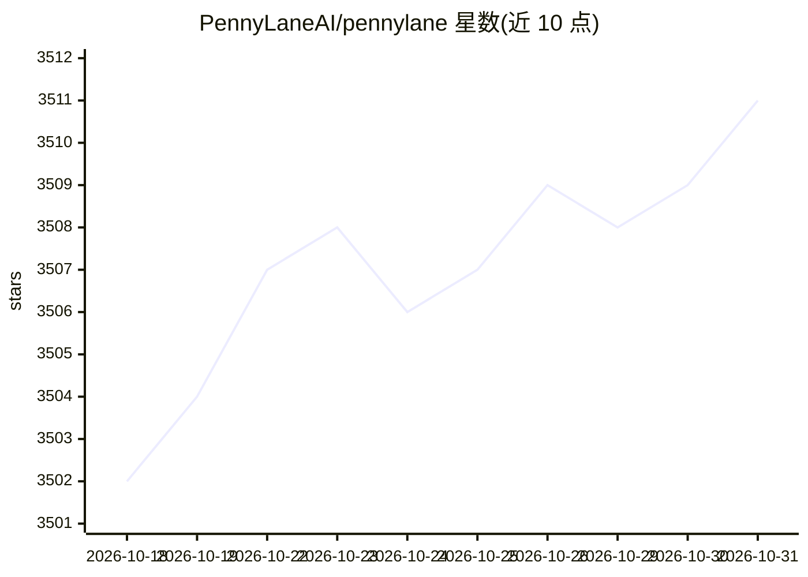

# PennyLaneAI/pennylane

⭐ 3,511 · Python · Apache-2.0 · 推送 2026-10-30 · [GitHub](https://github.com/PennyLaneAI/pennylane) · [官网](https://pennylane.ai) · 组织维护

**量子计算/量子机器学习/量子化学的开源软件平台**

PennyLane 是开源量子软件平台，覆盖量子计算、量子机器学习与量子化学，用于创建与执行量子算法。提供自动微分（autograd、JAX、PyTorch 等）、Catalyst 编译器、高性能 Lightning 模拟器（可运行于 GPU、超算与云端），并与超导、离子阱、中性原子、光子学等多类量子硬件集成，支持资源估计与面向硬件的电路编译。要求 Python 3.12 以上，通过 pip 安装，Docker 镜像发布于 Docker Hub。Apache 2.0 许可。

## 筛选速览

| 维度 | 判定 | 备注 |
|---|---|---|
| AI 角色 | `ai-ecosystem` | LLM/agent 周边工具 |
| 许可风险 | `permissive` | Apache-2.0 |
| 部署形态 | `library` | 以包/库形式分发 |
| 模型依赖 | — | README 未给出锁定关系 |
| 硬件要求 | — | 无带数字的原话,不猜 |
| 安装摩擦 | `low` | 无编译、无系统依赖或容器化 |
| 成熟度 | — | 结构信号不足 |

## 能力要点

- 混合量子-经典计算的自动微分
- Catalyst 编译器与 Lightning 高性能模拟器
- 硬件无关设计，集成多类量子硬件设备
- 提供研究 demo 库、Codebook 教程与讨论社区

## 适用场景

- 构建量子机器学习、量子化学与优化算法
- 在 GPU/超算/云端上模拟与执行量子电路
- 面向具体量子硬件做资源估计与电路编译

## 场景标签

 · 领域:量子计算/量子机器学习

## 证据(README 行号)

> L25:  PennyLane is an open-source quantum software platform for
> L27:  quantum machine learning,
> L41:  Whether executing, compiling, or analyzing, PennyLane is fast. Unlock production-grade performance with industrial

## 星数曲线

2026-10-18 3,502 → 2026-10-31 3,511（+9）

---
*卡片 v1 · prompt 1.4 · 生成 2026-10-20 · 置信度 high · 依据 README sha `9a48ab5db129` · [字段定义](../../DATASET.md)*
