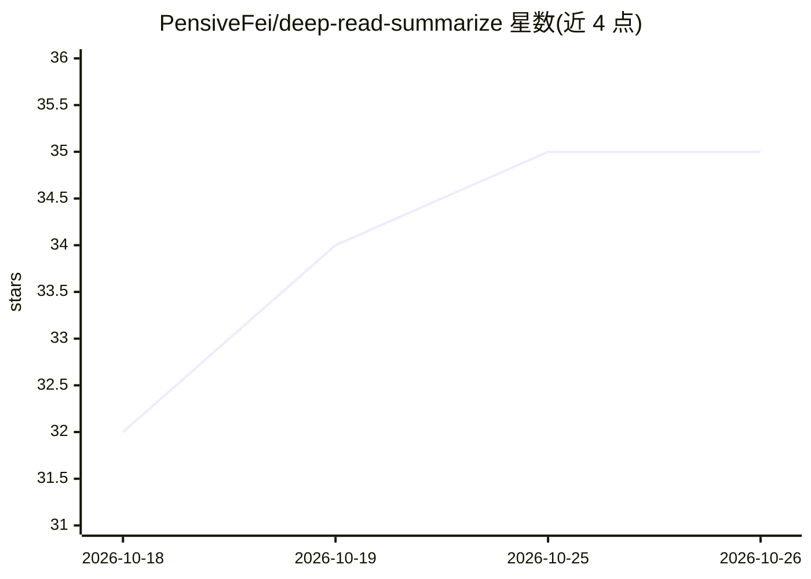

# PensiveFei/deep-read-summarize

⭐ 35 · JavaScript · MIT · 推送 2026-10-25 · [GitHub](https://github.com/PensiveFei/deep-read-summarize) · 个人维护 · 中文 README

**DSH 插件：把书籍/论文/视频/网页精读成结构化 Markdown 笔记**

面向 DeepSeek Harness（DSH）用户的精读工作流插件：输入 PDF/EPUB/MOBI 书籍、arXiv 论文、视频链接或网页，长内容分块后由并行子代理精读、合并，输出带 YAML frontmatter 的标准 Markdown 笔记，可直接放入 Obsidian/Logseq/静态站点。关键机制：JSON Schema 约束输出、关键引用标注页码/章节并经独立核验代理复核、无字幕视频用 faster-whisper（CPU 默认）自动转写、解析器可自定义扩展。限制：需 DSH 宿主环境（已验证 DSH 0.2.0-rc.2），DSH 处于 developer preview 接口可能变化；PDF 输入需系统级 poppler；转写/精读结果带非确定性。

## 筛选速览

| 维度 | 判定 | 备注 |
|---|---|---|
| AI 角色 | `ai-native` | 本体是模型或模型工具 |
| 许可风险 | `permissive` | MIT |
| 部署形态 | `library` | 以包/库形式分发 |
| 模型依赖 | locked-api |  |
| 硬件要求 | — | 无带数字的原话,不猜 |
| 安装摩擦 | `medium` | 含编译或系统依赖之一 |
| 成熟度 | — | 结构信号不足 |

## 能力要点

- 书籍(PDF/EPUB/MOBI)、论文(arXiv/PDF/HTML)、视频、网页四类输入的插件式解析器
- 分块 + 并行子代理精读 + 合并 + 质量校验的 MapReduce 工作流
- 输出标准 Markdown + YAML frontmatter（obsidian/generic/minimal 三档），Obsidian/Logseq/Hugo 可直接用
- 无字幕视频自动本地转写（faster-whisper small/int8/VAD，默认 CPU，无需 CUDA）

## 适用场景

- 把一篇 arXiv 论文或一本书快速变成带出处引用的结构化笔记
- 给无字幕视频生成完整逐字稿精读笔记
- 把精读笔记直接沉淀到 Obsidian 或 Jekyll/Hugo 站点

## 场景标签

`知识库管理` `AI 写作` · 领域:内容生成

## 证据(README 行号)

> L12: 给 DSH（DeepSeek Harness）写的一个精读工作流：输入一本书、一篇论文、一个视频链接或网页，输出一份结构化的标准 Markdown 笔记（YAML frontmatter，可直接放进 Obsidian / Logs
> L36: - 书籍（PDF/EPUB/MOBI）、论文（arXiv/PDF/HTML）、视频（**字幕优先，无字幕自动转写**，出品完整逐字稿精读）、网页
> L230: - **精读 LLM**：用宿主 DSH 的模型，不同上下文/推理模型 → 输出**质量、篇幅、速度**不同。

## 星数曲线

2026-10-18 32 → 2026-10-26 35（+3）

---
*卡片 v1 · prompt 1.4 · 生成 2026-10-25 · 置信度 mid · 依据 README sha `2cecdd2d755e` · [字段定义](../../DATASET.md)*
