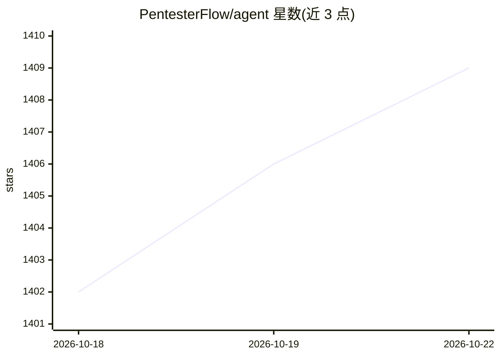

# PentesterFlow/agent

⭐ 1,409 · TypeScript · Apache-2.0 · 推送 2026-08-31 · [GitHub](https://github.com/PentesterFlow/agent) · [官网](https://pentesterflow.com) · 组织维护

**渗透测试人员的人在回路终端 AI 代理 CLI**

面向授权攻击性安全工作的开源终端助手：连接本地或托管 LLM，支持 Ollama、LM Studio、Groq、Gemini、Anthropic 等 OpenAI 兼容后端，按范围规划并调用真实渗透工具（Shell/HTTP/Burp/MCP），敏感操作前需人工批准，产出带证据的 Markdown 报告。内置项目与个人两级本地知识库用于跨会话学习，无需重训模型；支持会话保存、上下文快照与恢复。仅限有明确授权的系统使用。

## 筛选速览

| 维度 | 判定 | 备注 |
|---|---|---|
| AI 角色 | `ai-ecosystem` | LLM/agent 周边工具 |
| 许可风险 | `permissive` | Apache-2.0 |
| 部署形态 | `desktop` | 安装包/桌面程序 |
| 模型依赖 | local-ok | 支持本地模型 |
| 硬件要求 | — | 无带数字的原话,不猜 |
| 安装摩擦 | `low` | 无编译、无系统依赖或容器化 |
| 成熟度 | — | 结构信号不足 |

## 能力要点

- 人在回路权限分级（ask/auto-safe/yolo）与计划模式
- 本地 Continuous Learning 知识库，跨项目沉淀经验且不重训模型
- 多后端支持：Ollama、LM Studio、Groq、Kimi、Gemini、Anthropic 等
- 覆盖追踪与 /next 命令给出未测试项，findings 以证据化 Markdown 持久化

## 适用场景

- 授权渗透测试中按生命周期完成侦察、枚举、验证与报告
- Bug Bounty 猎人管理长周期测试的上下文与会话恢复
- 让 AI 代理调用 Burp 流量与 Shell 工具并保留人工审批

## 场景标签

`网络安全` · 领域:学习与行业

## 证据(README 行号)

> L27: authorized offensive-security work. It connects to local or hosted LLMs, plans
> L66: |Model backends|Ollama, LM Studio, Kimi, Groq, Gemini, Anthropic, and OpenAI-compatible APIs.|
> L161: PentesterFlow talks to any OpenAI-compatible endpoint plus native Gemini and

## 星数曲线

2026-10-18 1,402 → 2026-10-22 1,409（+7）

---
*卡片 v1 · prompt 1.4 · 生成 2026-10-21 · 置信度 high · 依据 README sha `5820451dc2b7` · [字段定义](../../DATASET.md)*
