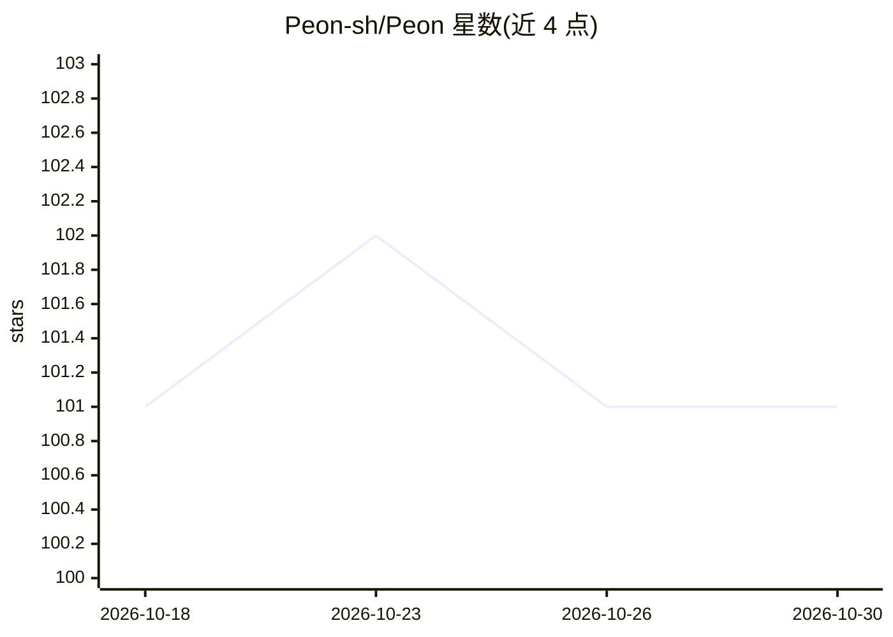

# Peon-sh/Peon

⭐ 101 · TypeScript · MIT · 推送 2026-10-28 · [GitHub](https://github.com/Peon-sh/Peon) · [官网](https://peon.sh) · 个人维护

**自托管部署平台：将 Git 应用、Compose、数据库部署到自有服务器**

面向需要掌控基础设施的开发者/团队的自托管部署平台：通过 SSH 将 Git 仓库或 Docker 镜像部署到自有服务器（Hetzner、DigitalOcean 或裸金属），支持 Docker Compose 栈、数据库、静态站点，提供 git push 部署、TLS、备份、日志与工作区/角色权限。技术栈为 Node.js 20+ 与 pnpm，自备 PostgreSQL，队列用 AWS SQS 或本地 ElasticMQ；后台 worker 处理部署与备份，另有 cron 调度与终端 WebSocket 服务。README 自称 Vercel/Heroku 的开源替代。

## 筛选速览

| 维度 | 判定 | 备注 |
|---|---|---|
| AI 角色 | `ai-ecosystem` | LLM/agent 周边工具 |
| 许可风险 | `permissive` | MIT |
| 部署形态 | `self-host` | docker 或自建部署 |
| 模型依赖 | — | README 未给出锁定关系 |
| 硬件要求 | — | 无带数字的原话,不猜 |
| 安装摩擦 | `low` | 无编译、无系统依赖或容器化 |
| 成熟度 | — | 结构信号不足 |

## 能力要点

- Git/Docker 镜像经 SSH 部署到自有服务器
- 一键服务模板（数据库、Compose 栈等）
- 工作区/项目多租户与基于角色的访问
- 自备 Postgres + SQS/ElasticMQ 的自托管架构

## 适用场景

- 把 Git 仓库应用部署到自己控制的服务器
- 自建 Vercel/Heroku 式的 PaaS 部署流程
- 在自有基础设施上管理数据库与 Compose 栈

## 场景标签

 · 领域:部署平台/DevOps

## 证据(README 行号)

> L3: Open-source, self-hostable deployment platform. Deploy Git apps, Docker Compose stacks, databases, and static sites 
> L5: Peon is the open alternative to Vercel, Heroku, and managed PaaS: git push to deploy, TLS, backups, logs, and team w
> L114: The script bumps the version (major / minor / patch), generates AI release notes, tags the commit, and publishes a

## 星数曲线

2026-10-18 101 → 2026-10-30 101（+0）

---
*卡片 v1 · prompt 1.4 · 生成 2026-10-23 · 置信度 low · 依据 README sha `ffff07a17ee1` · [字段定义](../../DATASET.md)*
