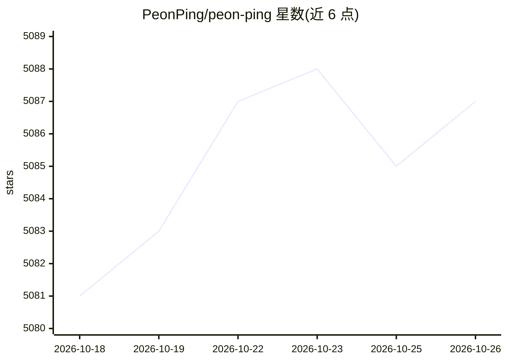

# PeonPing/peon-ping

⭐ 5,087 · Shell · MIT · 推送 2026-10-19 · [GitHub](https://github.com/PeonPing/peon-ping) · [官网](https://www.peonping.com) · 组织维护 · 中文 README

**AI 编程代理的语音/弹窗事件通知工具**

通过游戏角色语音（Warcraft/StarCraft/Portal/Zelda 等）与屏幕大横幅，在 AI 编程代理完成任务、需要授权、报错或触发限流时通知用户。以 hook 与 adapter 脚本接入 Claude Code、Codex、Cursor、OpenCode 等约 20 种代理/IDE，实现开放的 CESP（Coding Event Sound Pack）事件规范；另支持 MCP 让代理自选音效。安装途径含 Homebrew、安装脚本（macOS/Linux/WSL2/Windows）、git clone、Nix。Windows 上部分高级命令尚未实现，WSL2 播放 MP3 在 Win11 24H2+ 需 ffmpeg。

## 筛选速览

| 维度 | 判定 | 备注 |
|---|---|---|
| AI 角色 | `ai-enhanced` | 去掉 AI 部分产品仍成立 |
| 许可风险 | `permissive` | MIT |
| 部署形态 | `library` | 以包/库形式分发 |
| 模型依赖 | locked-api |  |
| 硬件要求 | — | 无带数字的原话,不猜 |
| 安装摩擦 | `medium` | 含编译或系统依赖之一 |
| 成熟度 | — | 结构信号不足 |

## 能力要点

- 支持约 20 种 AI 编程代理与 IDE 的 hook/adapter 接入
- 实现开放的 CESP 编码事件音效规范（7 类内置事件）
- 语音、桌面横幅、终端标签标题、手机推送四路独立开关
- 支持 macOS Focus 免打扰联动与 MCP 让代理自选音效

## 适用场景

- 切走终端窗口时不错过代理的完成/授权请求
- 在会议期间自动静音，会后恢复通知
- 用游戏语音包获得任务完成、报错、限流等事件的即时提醒

## 场景标签

 · 领域:开发者工具/终端通知

## 证据(README 行号)

> L10: **Game character voice lines + visual overlay notifications when your AI coding agent needs attention — or let the 
> L12: AI coding agents don't notify you when they finish or need permission. You tab away, lose focus, and waste 15 minut
> L166: Plus **large overlay banners** on every screen (macOS/WSL/MSYS2) and terminal tab titles (`● project: done`) — you

## 星数曲线

2026-10-18 5,081 → 2026-10-26 5,087（+6）

---
*卡片 v1 · prompt 1.4 · 生成 2026-10-20 · 置信度 mid · 依据 README sha `1dd8a284b841` · [字段定义](../../DATASET.md)*
