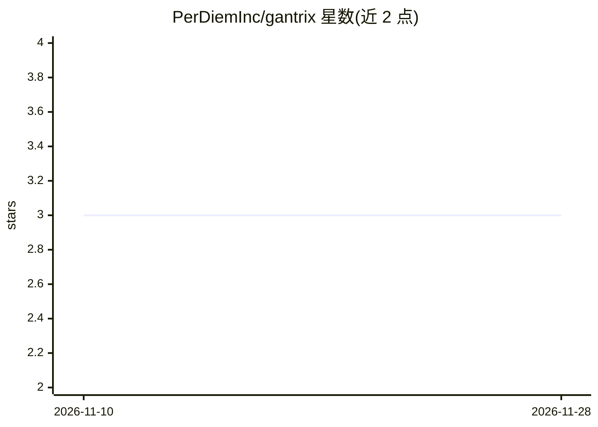

# PerDiemInc/gantrix

⭐ 3 · TypeScript · MIT · 推送 2026-11-26 · [GitHub](https://github.com/PerDiemInc/gantrix) · [官网](https://perdieminc.github.io/gantrix/) · 组织维护

**本地优先的多智能体编排器：规划-并行执行-评审目标达成**

以 Gantt 图方式运行 AI 智能体的编排器：输入目标后由 planner 分解为带依赖的步骤，持有 SKILL.md 文件夹与 MCP 服务器技能的智能体并行执行就绪步骤，judge 模型逐步校验结果，高风险工具执行前需用户批准，并在时间/token/重规划预算内重试与重规划。默认运行在本地 Ollama 模型上，可将执行切换到本机的 Claude Code 或 ChatGPT。技术栈为 LangGraph.js 与 BullMQ，附 Web 仪表盘、CLI 与 starter 智能体团队。

## 筛选速览

| 维度 | 判定 | 备注 |
|---|---|---|
| AI 角色 | `ai-ecosystem` | LLM/agent 周边工具 |
| 许可风险 | `permissive` | MIT |
| 部署形态 | `self-host` | docker 或自建部署 |
| 模型依赖 | local-ok | 支持本地模型 |
| 硬件要求 | — | 无带数字的原话,不猜 |
| 安装摩擦 | `low` | 无编译、无系统依赖或容器化 |
| 成熟度 | — | 结构信号不足 |

## 能力要点

- planner 分解依赖步骤，就绪步骤按智能体并发度并行执行
- judge 模型逐步校验结果，高风险工具需人工批准
- 技能以 SKILL.md 文件夹与 MCP 服务器形式添加
- 每个智能体可指定运行模型：本地 Ollama 默认，可切换 Claude Code/OpenAI/Anthropic

## 适用场景

- 把一个目标交给本地智能体团队自动分解并执行
- 在仪表盘上跟踪项目任务板与 Gantt 时间线
- 在本地模型与本机 Claude Code/ChatGPT 之间切换执行
- 通过 Cron 定时运行可复用的多步骤任务

## 场景标签

`Agent 框架` `多智能体` · 领域:Agent 开发

## 证据(README 行号)

> L5: **Gantrix is an open-source, local-first AI agent orchestrator.** Give it a goal and agents with
> L7: parallel on Ollama models, has a judge check each result, and asks you before risky tools run.
> L50: Compare: Gantrix vs CrewAI ·

## 星数曲线

2026-11-10 3 → 2026-11-28 3（+0）

---
*卡片 v1 · prompt 1.4 · 生成 2026-11-22 · 置信度 high · 依据 README sha `c04b3f383f91` · [字段定义](../../DATASET.md)*
