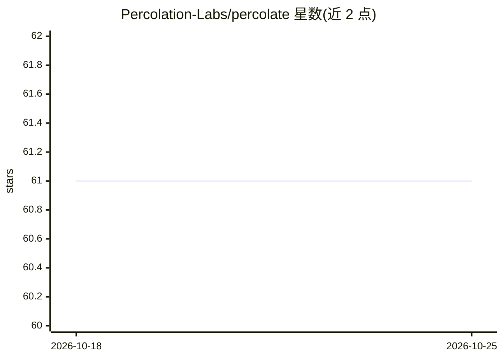

# Percolation-Labs/percolate

⭐ 61 · PLpgSQL · MIT · 推送 2026-10-23 · [GitHub](https://github.com/Percolation-Labs/percolate) · [官网](https://percolation-labs.github.io/percolate/) · 组织维护

**把 AI 工作流引擎与 agent 记忆放进 Postgres 的扩展与运行时**

由 Percolation Labs 开源的 AI 工作流引擎与 agent 记忆系统：agents、workflows、runs、documents 及其关联图全部以 Postgres 行存储，运行轨迹可 SQL 查询。仓库含两部分——纯 SQL 的 percolate 扩展（非超级用户可装，行级安全生效）与 Rust/pgrx 编写的 percolate_parser 编译解析器；core/ 是私有仓库 percolate-core（worker、Content Server、Agent Runtime 等 Python 进程）的只读镜像。安装与运行经 get-percolate 仓库（compose 文件、Helm chart、文档），镜像发布于 Docker Hub。限制：percolate-core 源码与部分设计文档不在本仓库。

## 筛选速览

| 维度 | 判定 | 备注 |
|---|---|---|
| AI 角色 | `ai-ecosystem` | LLM/agent 周边工具 |
| 许可风险 | `permissive` | MIT |
| 部署形态 | `library` | 以包/库形式分发 |
| 模型依赖 | — | README 未给出锁定关系 |
| 硬件要求 | — | 无带数字的原话,不猜 |
| 安装摩擦 | `low` | 无编译、无系统依赖或容器化 |
| 成熟度 | — | 结构信号不足 |

## 能力要点

- agents/workflows/runs/documents 及其图结构以 Postgres 行存储，运行轨迹可查询
- 纯 SQL 扩展可由非超级用户安装，行级安全生效
- Rust/pgrx 编译的解析器扩展 percolate_parser
- 镜像与 Python 包（percolate-core）经 Docker Hub 与 PyPI 发布

## 适用场景

- 在 Postgres 内运行 AI 工作流并查询每次运行的完整轨迹
- 为 agent 系统提供数据库内的记忆与文档图存储
- 自托管部署 AI agent 运行时（Docker compose 或 Helm）

## 场景标签

`Agent 记忆` `工作流自动化` · 领域:Agent 开发

## 证据(README 行号)

> L3: An AI workflow engine and agent memory inside Postgres. Agents, workflows, runs, documents and the graph over them
> L13: |`core/`|a read-only mirror of percolate-core (a private repository), the Python processes in front of the database

## 星数曲线

2026-10-18 61 → 2026-10-25 61（+0）

---
*卡片 v1 · prompt 1.4 · 生成 2026-10-24 · 置信度 high · 依据 README sha `09844fff17ba` · [字段定义](../../DATASET.md)*
