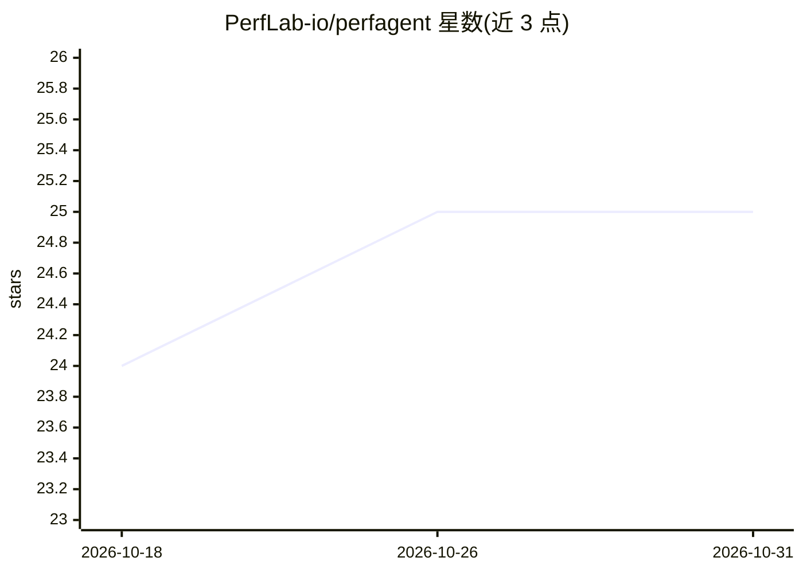

# PerfLab-io/perfagent

⭐ 25 · TypeScript · Apache-2.0 · 推送 2026-04-22 · [GitHub](https://github.com/PerfLab-io/perfagent) · [官网](https://agent.perflab.io) · 组织维护

**Web 性能分析工具：解析 Chrome trace 并提供 AI 优化建议**

基于 Next.js 构建的 Web 性能分析应用：上传并解析 Chrome DevTools 性能 trace，提供火焰图、网络瀑布图、交互时间线等可视化，分析 LCP/INP/CLS 等 Core Web Vitals 指标。AI 部分（基于 Vercel AI SDK 与 Mastra 编排）包括 Trace 助手、网络请求助手、性能主题研究报告生成与后续问题建议，通过聊天界面交互，并可生成 Markdown 优化报告。面向前端开发者，需自行部署运行。

## 筛选速览

| 维度 | 判定 | 备注 |
|---|---|---|
| AI 角色 | `ai-enhanced` | 去掉 AI 部分产品仍成立 |
| 许可风险 | `permissive` | Apache-2.0 |
| 部署形态 | `library` | 以包/库形式分发 |
| 模型依赖 | — | README 未给出锁定关系 |
| 硬件要求 | — | 无带数字的原话,不猜 |
| 安装摩擦 | `low` | 无编译、无系统依赖或容器化 |
| 成熟度 | — | 结构信号不足 |

## 能力要点

- 上传并处理 Chrome DevTools 性能 trace，分析 Core Web Vitals（LCP/INP/CLS）
- 火焰图、网络瀑布图、交互时间线可视化
- 基于 Mastra 编排的 Trace 助手与网络助手，聊天界面交互
- 生成含优化建议的 Markdown 报告

## 适用场景

- 上传 Chrome 性能 trace 定位性能瓶颈
- 通过与 AI 助手对话获取针对性的性能优化建议
- 生成可分享的 Web 性能分析报告

## 场景标签

`数据分析` · 领域:效率与自动化

## 证据(README 行号)

> L3: PerfAgent is an advanced web performance analysis tool that leverages AI to help
> L10: - **AI-Powered Analysis**: Utilizes large language models to analyze performance
> L101: - **Trace Assistant**: Analyzes performance traces and provides optimization

## 星数曲线

2026-10-18 24 → 2026-10-31 25（+1）

---
*卡片 v1 · prompt 1.4 · 生成 2026-10-27 · 置信度 low · 依据 README sha `7eb7a3be4848` · [字段定义](../../DATASET.md)*
