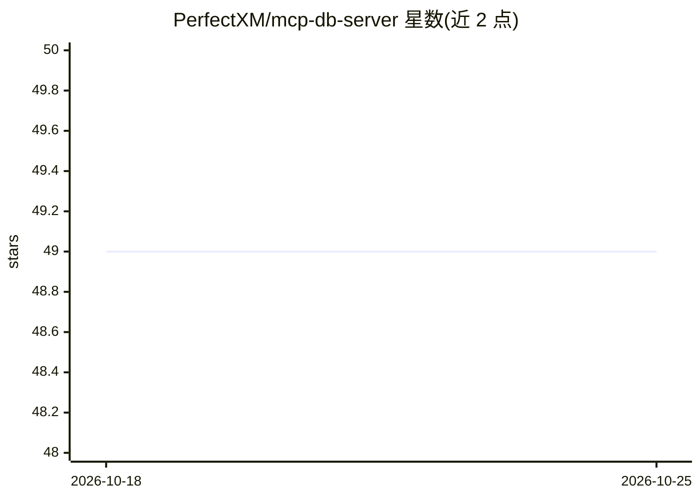

# PerfectXM/mcp-db-server

⭐ 49 · Java · MIT · 推送 2026-07-06 · [GitHub](https://github.com/PerfectXM/mcp-db-server) · 个人维护 · 中文 README

**无状态 MCP 数据库服务：让 AI 客户端直连六种数据库执行 SQL**

基于 Spring AI MCP Server 的 Java 数据库 MCP 服务，通过 SSE 传输对接 Claude Desktop、Cursor、Trae 等 AI 客户端。提供 6 个 MCP 工具（列表/表结构/索引/只读查询/写操作/元数据），支持 MySQL、PostgreSQL、H2、SQLite、SQL Server、Oracle。完全无状态：连接参数由客户端每次调用传入，服务端仅以 5 分钟 TTL 的 HikariCP 连接池短期缓存，不做额外权限拦截（权限取决于数据库用户自身 GRANT）。提供 Maven、Docker 与 JAR 三种部署方式。

## 筛选速览

| 维度 | 判定 | 备注 |
|---|---|---|
| AI 角色 | `ai-ecosystem` | LLM/agent 周边工具 |
| 许可风险 | `permissive` | MIT |
| 部署形态 | `self-host` | docker 或自建部署 |
| 模型依赖 | — | README 未给出锁定关系 |
| 硬件要求 | — | 无带数字的原话,不猜 |
| 安装摩擦 | `low` | 无编译、无系统依赖或容器化 |
| 成熟度 | — | 结构信号不足 |

## 能力要点

- 连接参数即传即用，服务端不持久化任何连接信息或数据
- 支持 MySQL/PostgreSQL/H2/SQLite/SQL Server/Oracle 六种数据库
- 6 个 MCP 工具覆盖表查询、结构、索引、SQL 读写与元数据
- 提供 Dockerfile 与 docker-compose.yml 部署方案

## 适用场景

- 让 Claude Desktop 或 Cursor 直接查询我配置的数据库
- AI 客户端免配置接入多个不同类型的数据库执行 SQL
- 需要服务端不留存数据库凭据的 MCP 数据库通道

## 场景标签

`数据分析` · 领域:效率与自动化

## 证据(README 行号)

> L8: 基于 **Spring AI MCP Server** 的通用数据库 MCP 服务。**完全无状态**——数据库连接信息由 AI 客户端在每次调用时传入，服务端不存储任何连接配置或数据。
> L16: - 🔌 **MCP 协议**：基于 Spring AI MCP Server，SSE 传输协议，无缝对接 Claude Desktop、Cursor 等 AI 客户端

## 星数曲线

2026-10-18 49 → 2026-10-25 49（+0）

---
*卡片 v1 · prompt 1.4 · 生成 2026-10-24 · 置信度 high · 依据 README sha `50900aa5a135` · [字段定义](../../DATASET.md)*
