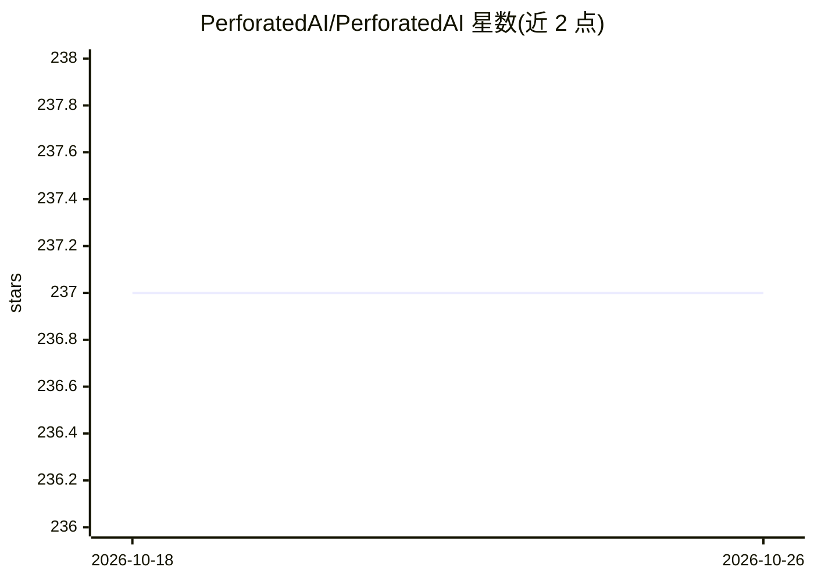

# PerforatedAI/PerforatedAI

⭐ 237 · Python · Apache-2.0 · 推送 2026-10-24 · [GitHub](https://github.com/PerforatedAI/PerforatedAI) · 组织维护

**给 PyTorch 训练加人工树突的训练增强库**

Apache 2.0 开源的 Python 库 perforatedai：在已有 PyTorch 网络中自动添加树突模块，通过验证分数驱动树突生长、自动调节学习率、支持多层同时处理，宣称可提升精度并降低参数量与数据需求（其标称的最佳结果来自商业版 Perforated Backpropagation™，不在本开源版内）。以 pip 安装、约十行代码集成，附 MNIST、TD3 强化学习、ImageNet ResNet-18 等示例，支持 PyTorch Lightning 与 Hugging Face 集成，另附带供 Claude Code/Copilot 等编码助手使用的 Agent Skills 与 MCP server。要求 Python 3.7+、PyTorch 1.9+。

## 筛选速览

| 维度 | 判定 | 备注 |
|---|---|---|
| AI 角色 | `ai-ecosystem` | LLM/agent 周边工具 |
| 许可风险 | `permissive` | Apache-2.0 |
| 部署形态 | `library` | 以包/库形式分发 |
| 模型依赖 | — | README 未给出锁定关系 |
| 硬件要求 | — | 无带数字的原话,不猜 |
| 安装摩擦 | `low` | 无编译、无系统依赖或容器化 |
| 成熟度 | — | 结构信号不足 |

## 能力要点

- 自动分析网络并注入树突模块，验证分数驱动的生长与学习率调节
- 约十行代码集成到现有 PyTorch 训练脚本
- 覆盖视觉、NLP、强化学习的示例，含 PyTorch Lightning / Hugging Face 集成
- 附带可安装到 Claude Code/Copilot/Codex/Cursor 的 Agent Skills

## 适用场景

- 我在 PyTorch 项目里加树突模块，尝试提升精度或压缩参数量
- 让 AI 编码助手自动完成集成代码
- 在强化学习或 Transformer 训练中引入树突机制做实验

## 场景标签

`微调` · 领域:训练与推理

## 证据(README 行号)

> L7: Perforated is a data-efficiency layer for machine learning that adds artificial **dendrites** to your neural network
> L22: pip install perforatedai
> L64: - **[PyTorch Lightning][lightning-example]** - Using PAI with popular training frameworks

## 星数曲线

2026-10-18 237 → 2026-10-26 237（+0）

---
*卡片 v1 · prompt 1.4 · 生成 2026-10-22 · 置信度 mid · 依据 README sha `f3eba46fe523` · [字段定义](../../DATASET.md)*
