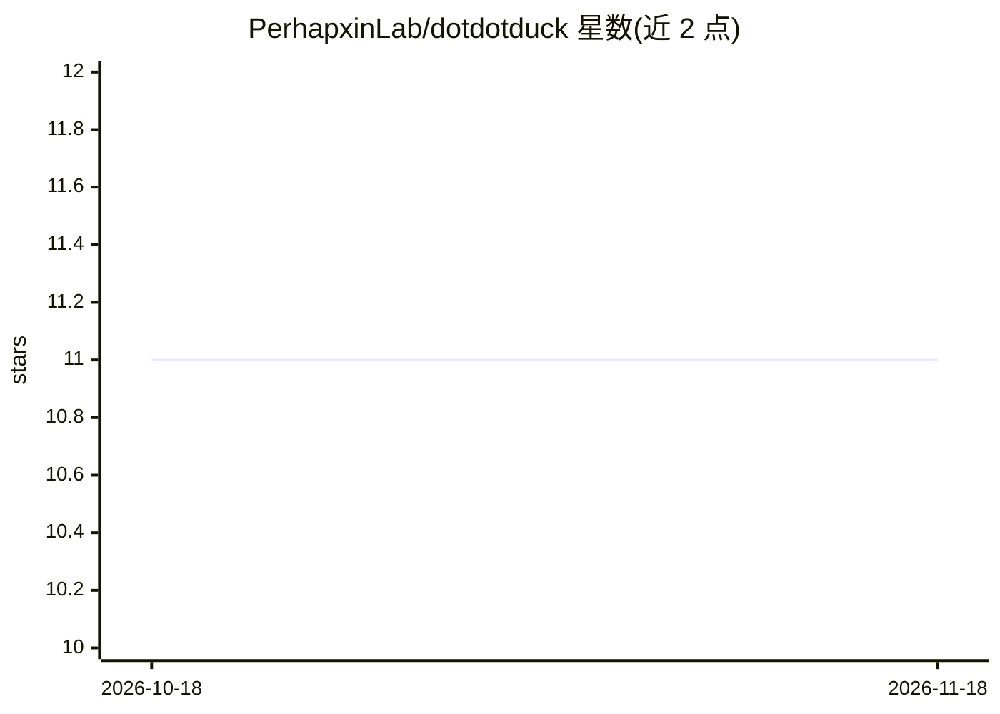

# PerhapxinLab/dotdotduck

⭐ 11 · TypeScript · AGPL-3.0 · 推送 2026-10-17 · [GitHub](https://github.com/PerhapxinLab/dotdotduck) · [官网](https://dddk.perhapxin.com) · 组织维护 · 中文 README

**把现有网站嵌入 AI 能力的 SDK：命令面板+DOM Agent+语音+内联 AI**

面向网站开发者的嵌入式 AI SDK，随页面加载并直接操作 DOM，而非角落聊天挂件。提供 Cmd/Ctrl+K 命令面板（零内置命令，条目全由宿主定义）、DOM-grounded WebAgent（逐步叙述、空格门控确认、可插拔动作包）、选中文本的内联 AI 工具栏、按住空格语音输入与长按 Dwell 元素选中、主动式提问、结构化意图事件流及内置仪表盘。LLM 密钥由宿主自带，支持按角色路由；STT 默认浏览器 Web Speech，可替换。移动端提供 FAB 与触控手势。

## 筛选速览

| 维度 | 判定 | 备注 |
|---|---|---|
| AI 角色 | `ai-ecosystem` | LLM/agent 周边工具 |
| 许可风险 | `viral` | AGPL-3.0 |
| 部署形态 | `library` | 以包/库形式分发 |
| 模型依赖 | — | README 未给出锁定关系 |
| 硬件要求 | — | 无带数字的原话,不猜 |
| 安装摩擦 | `low` | 无编译、无系统依赖或容器化 |
| 成熟度 | `idea` | |

## 能力要点

- Cmd/Ctrl+K 命令面板，前缀路由（/、@、#）与内联/模态两种挂载
- DOM-grounded WebAgent：逐步叙述、空格门控确认、可选动作包与自定义工具
- 语音（Web Speech 默认、transcribe 回调可换）、长按 Dwell、拖拽截图三种物理入口
- 全交互产出类型化意图事件流，附内置仪表盘路由

## 适用场景

- 给现有 SaaS 产品加命令面板与页面内 AI 操作能力
- 让 Agent 代用户完成页面内任务如查订单、改套餐
- 客服场景：页面内直接解答并执行常用操作
- 跨境产品用一条命令实现页面双语对照翻译

## 场景标签

`浏览器自动化` · 领域:效率与自动化

## 证据(README 行号)

> L5:  An embedded AI SDK that lives inside your page and operates the DOM — not a chatbot bolted to the corner.
> L31: - **DOM-grounded autonomous loop.** Reads the visible page, picks one tool at a time, narrates each step in the sub

## 星数曲线

2026-10-18 11 → 2026-11-18 11（+0）

---
*卡片 v1 · prompt 1.4 · 生成 2026-11-18 · 置信度 high · 依据 README sha `6b6b774abc28` · [字段定义](../../DATASET.md)*
