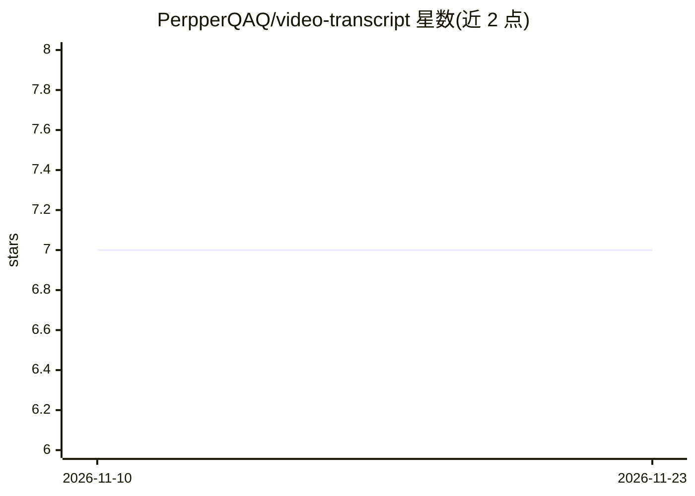

# PerpperQAQ/video-transcript

⭐ 7 · Python · MIT · 推送 2026-10-31 · [GitHub](https://github.com/PerpperQAQ/video-transcript) · 个人维护 · 中文 README

**Agent Skill：把抖音/B站视频链接转成带时间轴的文案与结构化总结**

一个兼容 HanaAgent / Claude Code 的 Agent Skill：接收视频链接后按平台走不同链路——抖音经 Playwright 抓直链并调用阿里云百炼批量 ASR，B 站走脚本下载音频、切段并发实时 ASR，产出带 [mm:ss] 时间轴的逐句文案；再由 LLM 生成核心观点、观点拆解、金句与关键结论的结构化总结，存为上半总结、下半原文的 Markdown。需百炼密钥、ffmpeg，抖音链路另需本地 Traffic Compass 服务与登录 Cookie；B 站链路独立可跑。

## 筛选速览

| 维度 | 判定 | 备注 |
|---|---|---|
| AI 角色 | `ai-native` | 本体是模型或模型工具 |
| 许可风险 | `permissive` | MIT |
| 部署形态 | `None` |  |
| 模型依赖 | — | README 未给出锁定关系 |
| 硬件要求 | — | 无带数字的原话,不猜 |
| 安装摩擦 | `medium` | 含编译或系统依赖之一 |
| 成熟度 | — | 结构信号不足 |

## 能力要点

- 抖音与 B 站两条提取链路，产出带时间轴的逐句文案
- B 站 10 段并发识别，段级结果缓存可断点补跑
- 总结+完整原文合一的 Markdown 输出便于归档引用
- 采用渐进式披露，细节文档按需从 references/ 读取

## 适用场景

- 把短视频/长视频变成可引用的图文文案存档
- 给没时间看视频的人快速提炼核心观点
- 批量为视频内容生成带时间戳的转录稿

## 场景标签

`语音识别` `AI 写作` · 领域:内容生成

## 证据(README 行号)

> L10: 一个 **Agent Skill**（兼容 HanaAgent / Claude Code 等支持 Skill 的 Agent）。给它一条视频链接，它会：
> L13:  - **抖音**：调用本地 **Traffic Compass** 服务（Playwright 抓直链 + 阿里云百炼批量 ASR）
> L14:  - **B 站**：`scripts/bili_asr.py`（音频直链下载 → 转码切段 → 百炼实时 ASR 并发），产出**带 `[mm:ss]` 时间轴**的逐句文案

## 星数曲线

2026-11-10 7 → 2026-11-23 7（+0）

---
*卡片 v1 · prompt 1.4 · 生成 2026-11-20 · 置信度 high · 依据 README sha `4e2a6ad1f8e1` · [字段定义](../../DATASET.md)*
