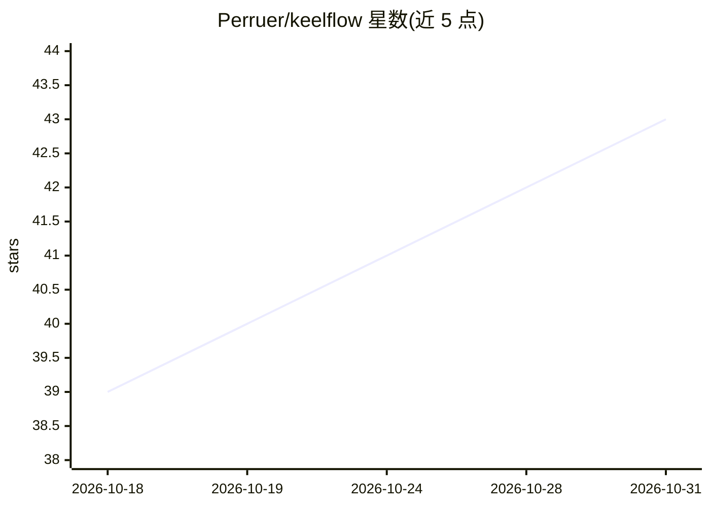

# Perruer/keelflow

⭐ 43 · TypeScript · Apache-2.0 · 推送 2026-10-21 · [GitHub](https://github.com/Perruer/keelflow) · [官网](https://github.com/Perruer/keelflow#quick-start) · 个人维护 · 中文 README

**Flowise 的安全维护分支：可视化构建 AI agent 与 LLM 工作流**

自托管的低代码平台，用于可视化搭建 AI agent、LLM 工作流、聊天机器人和 RAG 流程。作为 Flowise 3.1.4 归档后的延续：修复漏洞、更新依赖、移除商用许可代码并全面改为 Apache-2.0；提供单一 owner 账户加按权限划分的 API key、服务端会话、内置数据集与评测功能，沿用原有节点、API 与 embed 组件，可直接迁移既有数据。以 Docker 镜像（amd64/arm64）或 Node.js 24 + pnpm 10 源码运行。

## 筛选速览

| 维度 | 判定 | 备注 |
|---|---|---|
| AI 角色 | `ai-ecosystem` | LLM/agent 周边工具 |
| 许可风险 | `permissive` | Apache-2.0 |
| 部署形态 | `self-host` | docker 或自建部署 |
| 模型依赖 | — | README 未给出锁定关系 |
| 硬件要求 | — | 无带数字的原话,不猜 |
| 安装摩擦 | `low` | 无编译、无系统依赖或容器化 |
| 成熟度 | — | 结构信号不足 |

## 能力要点

- 修复 Flowise 遗留漏洞：依赖公告从 385（19 critical）降至 153（1 critical）
- Apache-2.0 单一许可，移除商业代码并替换为独立实现
- 内置原本付费的数据集、评测与服务器日志功能
- 可直接沿用 Flowise 的 flows、凭证、API key 与数据库迁移

## 适用场景

- 自助托管可视化 LLM 工作流与 agent 编排平台
- 从已停维的 Flowise 无缝迁移现有流程与数据
- 在合规要求下运行去掉第三方跟踪请求的自托管聊天机器人

## 场景标签

`Agent 框架` `工作流自动化` `RAG` `模型评测` · 领域:Agent 开发

## 证据(README 行号)

> L4:  Build AI agents and LLM workflows visually. Self-hosted, security-maintained continuation of Flowise.
> L30: Fixed advisories and hardening are listed in the changelog. Everything that is not listed there works as in Flowise

## 星数曲线

2026-10-18 39 → 2026-10-31 43（+4）

---
*卡片 v1 · prompt 1.4 · 生成 2026-10-25 · 置信度 mid · 依据 README sha `2216c9a1bfcd` · [字段定义](../../DATASET.md)*
