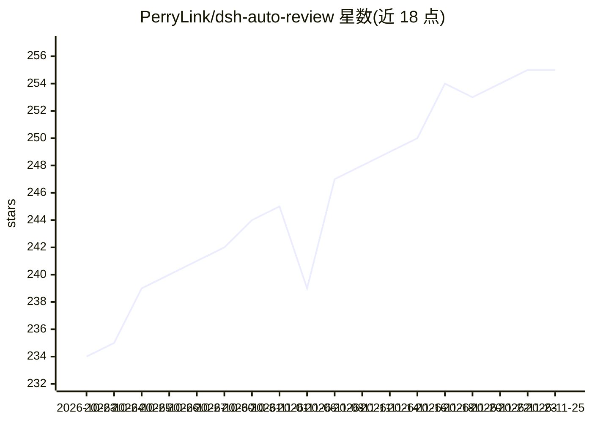

# PerryLink/dsh-auto-review

⭐ 255 · TypeScript · Apache-2.0 · 推送 2026-11-23 · [GitHub](https://github.com/PerryLink/dsh-auto-review) · [官网](https://www.npmjs.com/package/dsh-auto-review) · 个人维护 · 中文 README

**为 DeepSeek Harness 提供第二模型自动审批裁决的插件**

面向 DeepSeek Harness 的社区审批插件：当工具调用越过沙箱边界（ai 策略）时，只读审查子代理读取脱敏后的工具参数、工作区证据与风险规则，返回结构化 {decision, reason, riskLevel} 裁决；审查失败走 fallbackPolicy（默认 rejected，失败关闭），拒绝理由经 callId 注入工具结果，全部决策可由会话日志重建。附带 dsh-eval 代理评估引擎与独立 stdio MCP 服务器（确定性规则+缓存，无模型）。面向使用 DeepSeek Harness 的开发者。

## 筛选速览

| 维度 | 判定 | 备注 |
|---|---|---|
| AI 角色 | `ai-ecosystem` | LLM/agent 周边工具 |
| 许可风险 | `permissive` | Apache-2.0 |
| 部署形态 | `library` | 以包/库形式分发 |
| 模型依赖 | locked-api |  |
| 硬件要求 | — | 无带数字的原话,不猜 |
| 安装摩擦 | `low` | 无编译、无系统依赖或容器化 |
| 成熟度 | — | 结构信号不足 |

## 能力要点

- 只读审查子代理返回结构化 allow/deny 裁决，默认失败关闭
- 拒绝理由注入被拒工具结果，附 /auto-review approve 一次性覆盖与拒绝熔断器
- 可选 Phocinae 本地非生成式后端（默认 0.45 置信度，91 条命令基准 0/58 破坏性放行）
- 附带 dsh-eval YAML 评估引擎与独立 MCP 服务器

## 适用场景

- 为 DeepSeek Harness 代理的无人在环工具调用自动审批
- 需要每次 AI 裁决可从会话日志审计回放的团队
- 用 dsh-eval 对代理行为做 CI 回归门禁
- 通过 MCP 在外部客户端消费确定性风险规则裁决

## 场景标签

`模型评测` · 领域:评测与运维

## 证据(README 行号)

> L9: 面向 DeepSeek Harness 的第二模型 AI 审批插件：当动作越过沙箱边界，一个只读审查子代理读取证据并返回带理由的裁决，默认失败关闭。
> L92: `dsh-auto-review` 在 `approval/request` answerer 链上加入第二模型：
> L164: |`dsh-eval`|CLI|YAML 驱动的代理评估引擎（`bin/dsh-eval.mjs`）|

## 星数曲线

2026-10-23 234 → 2026-11-25 255（+21）

---
*卡片 v1 · prompt 1.4 · 生成 2026-11-25 · 置信度 mid · 依据 README sha `aae6e19d8dce` · [字段定义](../../DATASET.md)*
