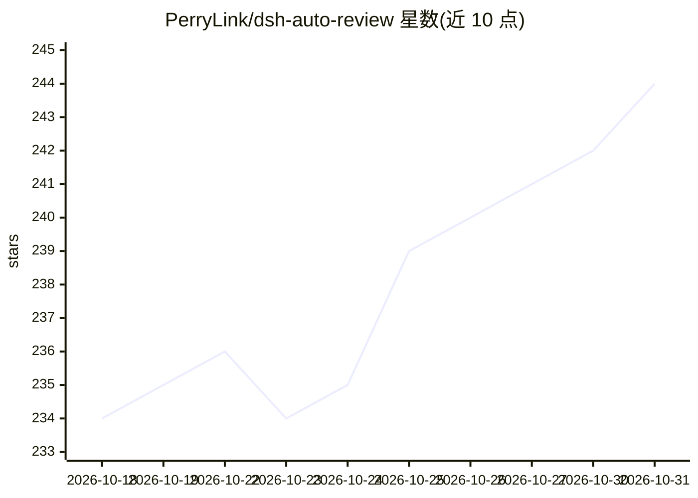

# PerryLink/dsh-auto-review

⭐ 244 · TypeScript · Apache-2.0 · 推送 2026-10-28 · [GitHub](https://github.com/PerryLink/dsh-auto-review) · [官网](https://perrylink.github.io/plugins/dsh-auto-review/) · 个人维护 · 中文 README

**DeepSeek Harness 审批链插件：第二模型自动评审 allow/deny**

面向 DeepSeek Harness 的审批环节插件：当 agent 动作越过沙箱边界时，由一个只读评审子代理（工具白名单 read/glob/grep）读取工作区证据与已流式的工具调用参数，返回结构化裁决 { decision, reason, riskLevel }。默认失败即关闭（fallbackPolicy 默认 rejected）；deny 理由会注入被拒工具结果反馈给调用模型；全部裁决可由会话日志重建（approval/asked → autoReview/verdict → approval/decided）。提供按工具策略（ai/human/never）、正则风险规则、熔断器与一次性 /auto-review approve 覆盖等配置项，通过 dsh plugin 命令安装。

## 筛选速览

| 维度 | 判定 | 备注 |
|---|---|---|
| AI 角色 | `ai-ecosystem` | LLM/agent 周边工具 |
| 许可风险 | `permissive` | Apache-2.0 |
| 部署形态 | `library` | 以包/库形式分发 |
| 模型依赖 | locked-api |  |
| 硬件要求 | — | 无带数字的原话,不猜 |
| 安装摩擦 | `low` | 无编译、无系统依赖或容器化 |
| 成熟度 | — | 结构信号不足 |

## 能力要点

- 只读评审子代理返回结构化 allow/deny 裁决并附理由
- 默认 fail-closed：评审崩溃/超时/模式不匹配走 rejected 回退
- deny 理由注入被拒工具结果，回传给调用模型
- 会话日志全量可审计（approval/asked → autoReview/verdict → approval/decided）

## 适用场景

- 让第二模型代替人工审批 agent 的 bash/write 等越界动作
- 为高风险动作配置正则风险规则与熔断策略
- 从会话日志审计每条自动审批裁决的依据

## 场景标签

 · 领域:开发者工具/Agent 安全

## 证据(README 行号)

> L6: **Second-model AI approval for DeepSeek Harness — a read-only reviewer subagent decides allow/deny on the approval c
> L66: `dsh-auto-review` puts a second model on the `approval/request` answerer chain:
> L69: 2. **Read-only reviewer subagent** — a one-shot fork with a `read`/`glob`/`grep` tool allow-list returns a structur

## 星数曲线

2026-10-18 234 → 2026-10-31 244（+10）

---
*卡片 v1 · prompt 1.4 · 生成 2026-10-22 · 置信度 high · 依据 README sha `36a451915e8f` · [字段定义](../../DATASET.md)*
