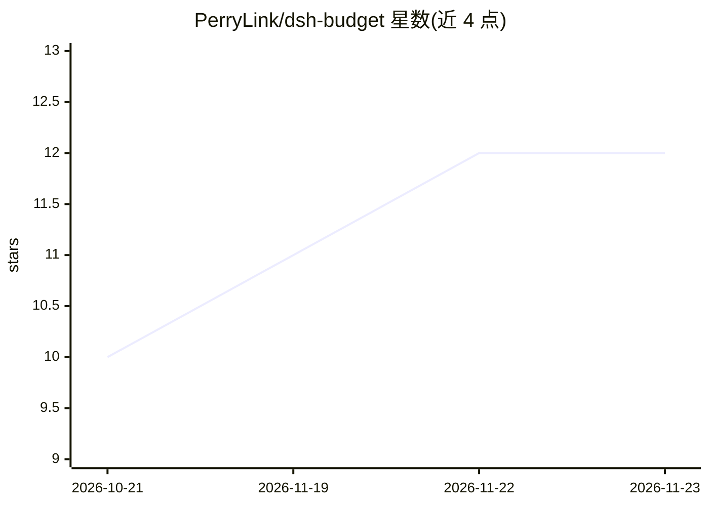

# PerryLink/dsh-budget

⭐ 12 · TypeScript · Apache-2.0 · 推送 2026-11-22 · [GitHub](https://github.com/PerryLink/dsh-budget) · [官网](https://www.npmjs.com/package/dsh-budget) · 个人维护 · 中文 README

**DSH 插件：按会话/日/月计量 token 成本、碳足迹与延迟并设预算闸门**

DeepSeek Harness 的社区成本治理插件：从 session/event 事件流事后计量 token（缓存输入/输出/缓存读写）与美元成本，换算为碳足迹与每模型延迟百分位，记入会话/日/月三档预算账本；超限后按 alert/block/degrade 三种策略处置，block 会在 llm/stream 接缝短路下一次调用。提供 Settings 预算标签页与 /budget 命令。通过 dsh plugin 命令从 git/npm/tarball 安装。自 2026-10-05 起冻结，README 指向 dsh-cost-meter 作为更广泛采用的实现。

## 筛选速览

| 维度 | 判定 | 备注 |
|---|---|---|
| AI 角色 | `ai-ecosystem` | LLM/agent 周边工具 |
| 许可风险 | `permissive` | Apache-2.0 |
| 部署形态 | `library` | 以包/库形式分发 |
| 模型依赖 | locked-api |  |
| 硬件要求 | — | 无带数字的原话,不猜 |
| 安装摩擦 | `low` | 无编译、无系统依赖或容器化 |
| 成熟度 | — | 结构信号不足 |

## 能力要点

- 按模型/会话/日聚合 token、成本、碳足迹计量
- 三档预算封顶与 alert/block/degrade 超限策略，阈值 webhook 告警
- token→碳足迹桥（kWh/token × PUE × 区域电网强度）与延迟百分位
- Settings 预算标签页与 /budget、/budget models、/budget unblock 命令

## 适用场景

- 为 DeepSeek Harness 会话设置日/月预算并在超限时阻断请求
- 查看每个模型的 token 开销与延迟分布
- 估算 AI 用量的碳足迹（按区域电网强度）

## 场景标签

`LLM 可观测性` · 领域:评测与运维

## 证据(README 行号)

> L5: **Cost governance for DeepSeek Harness: budgets, carbon, and latency in one panel.**
> L51:  dsh-budget structure: session/event usage is metered after the fact, converted in-process to cost, carbon and late
> L89: |Surfaces|Host + Web client (Settings budget tab); `/budget` command|

## 星数曲线

2026-10-21 10 → 2026-11-23 12（+2）

---
*卡片 v1 · prompt 1.4 · 生成 2026-11-19 · 置信度 high · 依据 README sha `41831a659b80` · [字段定义](../../DATASET.md)*
