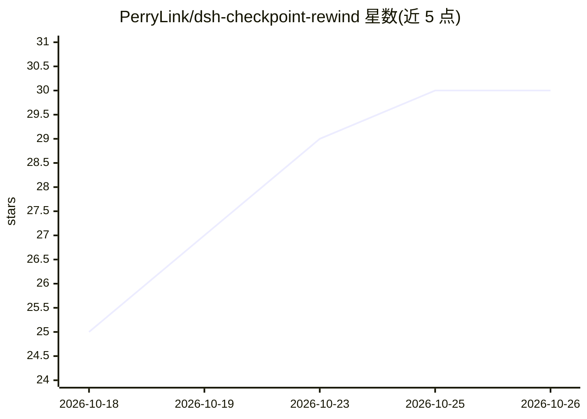

# PerryLink/dsh-checkpoint-rewind

⭐ 30 · JavaScript · Apache-2.0 · 推送 2026-10-24 · [GitHub](https://github.com/PerryLink/dsh-checkpoint-rewind) · [官网](https://perrylink.github.io/plugins/dsh-checkpoint-rewind/) · 个人维护 · 中文 README

**DeepSeek Harness 的检查点/回滚插件：三态快照一键恢复**

面向 DeepSeek Harness（dsh）的插件，在每次工作区变更、定时、手动及回滚前捕获检查点，统一记录工作区（git tree SHA 或副本清单）、会话游标与插件配置三态，通过 /rewind 一条命令回滚其中一个或全部。快照用 git stash create/commit-tree 生成不引用对象，不触碰工作树与历史；非 git 目录降级为带硬链接复制的增量 copy 提供方。会话回滚经 SessionStore.fork 重放到检查点边界生成子会话，原会话保留完整历史。不调用模型，快照与恢复为确定性操作。

## 筛选速览

| 维度 | 判定 | 备注 |
|---|---|---|
| AI 角色 | `ai-ecosystem` | LLM/agent 周边工具 |
| 许可风险 | `permissive` | Apache-2.0 |
| 部署形态 | `library` | 以包/库形式分发 |
| 模型依赖 | locked-api |  |
| 硬件要求 | — | 无带数字的原话,不猜 |
| 安装摩擦 | `low` | 无编译、无系统依赖或容器化 |
| 成熟度 | — | 结构信号不足 |

## 能力要点

- 工作区+会话+配置三态检查点，/rewind 一次性恢复
- git-first 快照：stash create/commit-tree 生成不引用对象，不影响工作树与历史
- 四类捕获触发：变更工具前、定时、手动 /checkpoint、回滚前守卫
- preview 只读影响报告，diff 比较两个检查点，clear 按会话或全量清理

## 适用场景

- AI 编码 agent 改坏文件后一键回到第 N 步
- 在回滚前先预览哪些文件会被覆盖
- 保留原会话完整历史的同时派生回滚点子会话继续工作

## 场景标签

 · 领域:开发者工具/AI agent 基础设施

## 证据(README 行号)

> L7: **Unified DeepSeek Harness checkpoints — session + workspace + config three-state snapshots with one-shot rollback.*
> L9: *The Claude Code Checkpoints equivalent, built as a capability-seam plugin: capture before every mutation, restore a
> L76: 3. **git-first provider** — `git stash create` / `commit-tree` produce unreferenced snapshot objects that never tou

## 星数曲线

2026-10-18 25 → 2026-10-26 30（+5）

---
*卡片 v1 · prompt 1.4 · 生成 2026-10-26 · 置信度 high · 依据 README sha `e3c7f4610649` · [字段定义](../../DATASET.md)*
