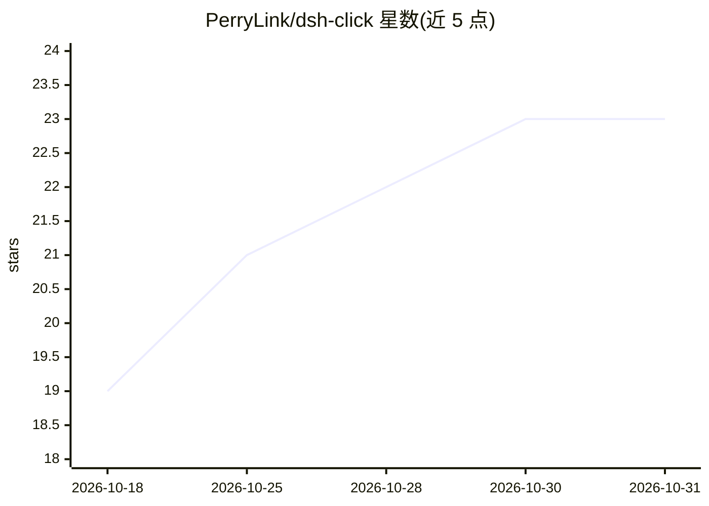

# PerryLink/dsh-click

⭐ 23 · TypeScript · Apache-2.0 · 推送 2026-10-27 · [GitHub](https://github.com/PerryLink/dsh-click) · [官网](https://perrylink.github.io/plugins/dsh-click/) · 个人维护 · 中文 README

**DeepSeek Harness 的原生桌面控制插件：看屏幕、点击输入、审批把关**

面向 DeepSeek Harness（DSH）的插件，为 agent 提供桌面 observe→act 循环：screen_shot/screen_read 返回窗口截图与无障碍树结构化观察，click/type/scroll/key/app_list/app_launch 执行操作。所有变更动作经四道安全边界：动作必须引用新鲜观察（像素哈希+时效校验）、默认 ctx.approval 审批门、动作前后进程身份验证、会话日志审计。Windows 优先（UIAutomation+Win32，捆绑 PowerShell helper），macOS/Linux 后端保留但未实现、全部调用失败关闭。输入不抢前台焦点。

## 筛选速览

| 维度 | 判定 | 备注 |
|---|---|---|
| AI 角色 | `ai-ecosystem` | LLM/agent 周边工具 |
| 许可风险 | `permissive` | Apache-2.0 |
| 部署形态 | `desktop` | 安装包/桌面程序 |
| 模型依赖 | locked-api |  |
| 硬件要求 | — | 无带数字的原话,不猜 |
| 安装摩擦 | `low` | 无编译、无系统依赖或容器化 |
| 成熟度 | — | 结构信号不足 |

## 能力要点

- screen_read 输出无障碍树+像素提示的结构化文本，纯文本模型可用
- 变更动作默认经审批门，且要求引用新鲜观察（像素哈希/时效）
- 动作前后校验进程 pid/exe 身份，变更即拒绝（PROCESS_CHANGED）
- 通过 UIA 或窗口消息投递输入，默认不抢前台焦点

## 适用场景

- 让 DSH agent 观察并操作 Windows 桌面应用（如记事本输入与回读）
- 以审批门+审计日志方式受控地自动化桌面操作
- 枚举运行中应用并按名称/路径启动程序

## 场景标签

`GUI 自动化` · 领域:效率与自动化

## 证据(README 行号)

> L46: Cross-platform native desktop control for DeepSeek Harness — Windows first.
> L65: `dsh-click` gives the harness a complete observe → act loop over native desktop applications:

## 星数曲线

2026-10-18 19 → 2026-10-31 23（+4）

---
*卡片 v1 · prompt 1.4 · 生成 2026-10-28 · 置信度 high · 依据 README sha `0fba450f0a76` · [字段定义](../../DATASET.md)*
