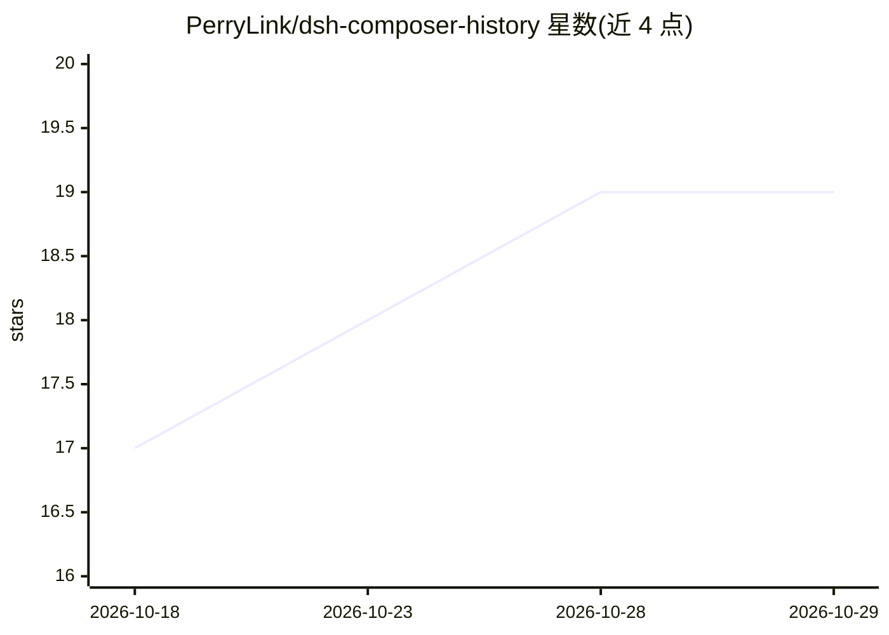

# PerryLink/dsh-composer-history

⭐ 19 · TypeScript · Apache-2.0 · 推送 2026-10-27 · [GitHub](https://github.com/PerryLink/dsh-composer-history) · [官网](https://perrylink.github.io/plugins/dsh-composer-history/) · 个人维护 · 中文 README

**DeepSeek Harness 网页输入框的终端式历史插件**

面向 DeepSeek Harness Web GUI 编辑器的客户端插件：提供边缘优先的 ↑/↓ 历史回溯（暂存并精确恢复草稿与光标）、浏览器本地持久化历史、Ctrl+R 反向搜索、/save 与 /load 代码片段、带变量的提示模板，以及把压缩摘要纳入回溯/搜索的滑窗上下文感知。纯 UI 行为：不发起模型请求、不改 agent 循环。需 DSH dsh>=0.2.1、Node 22.19+/24+，通过 dsh plugin 命令或 tarball 安装，提供大量键位与行为配置项及 JSON 备份导入导出。

## 筛选速览

| 维度 | 判定 | 备注 |
|---|---|---|
| AI 角色 | `ai-ecosystem` | LLM/agent 周边工具 |
| 许可风险 | `permissive` | Apache-2.0 |
| 部署形态 | `library` | 以包/库形式分发 |
| 模型依赖 | locked-api |  |
| 硬件要求 | — | 无带数字的原话,不猜 |
| 安装摩擦 | `low` | 无编译、无系统依赖或容器化 |
| 成熟度 | — | 结构信号不足 |

## 能力要点

- 边缘优先 ↑/↓ 回溯，暂存并精确恢复 {draft, caret}
- Ctrl+R 对合并的历史/片段/模板做反向搜索
- 压缩摘要以 [compacted] 条目进入回溯与搜索，并附一键 /compact 通知
- 四库（历史/片段/模板/洞察）版本化 JSON 备份导出导入

## 适用场景

- 在 Harness 网页输入框里用终端习惯翻阅和复用历史输入
- 保存并快速插入常用提示片段与模板
- 上下文被压缩后仍能回看被压缩的摘要内容

## 场景标签

`提示工程` · 领域:Agent 开发

## 证据(README 行号)

> L9: **Terminal-style input history for the DeepSeek Harness Web GUI composer.**
> L63: |Model|Any (no model requests — pure UI behavior)|
> L83: Pure UI behavior: no session events, no agent-loop changes, no model requests. Recalled text only enters the ordina

## 星数曲线

2026-10-18 17 → 2026-10-29 19（+2）

---
*卡片 v1 · prompt 1.4 · 生成 2026-10-28 · 置信度 high · 依据 README sha `8339ac269a91` · [字段定义](../../DATASET.md)*
