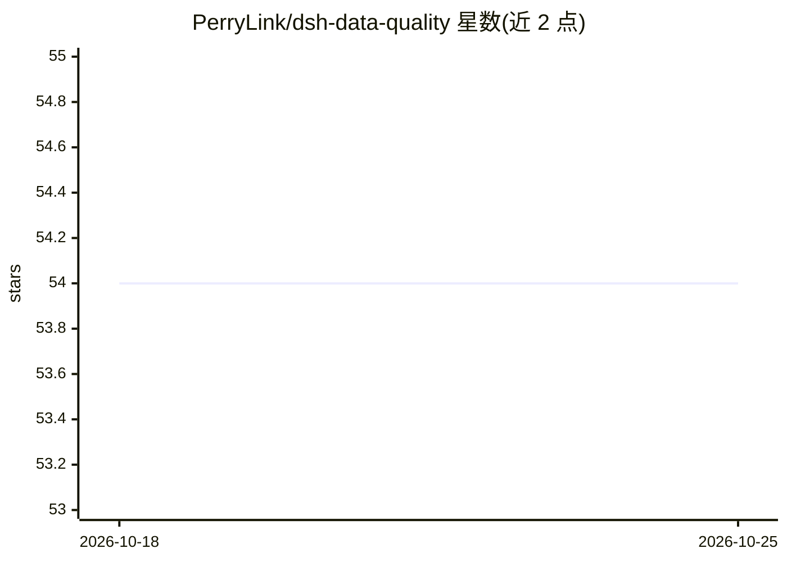

# PerryLink/dsh-data-quality

⭐ 54 · TypeScript · Apache-2.0 · 推送 2026-10-24 · [GitHub](https://github.com/PerryLink/dsh-data-quality) · [官网](https://perrylink.github.io/plugins/dsh-data-quality/) · 个人维护 · 中文 README

**DeepSeek Harness 插件：数据集剖析、清洗与校验的确定性工具**

面向 DeepSeek Harness（dsh）的 Cordis 插件，通过 ctx.dataQuality 服务向 agent 暴露 data_profile / data_clean / data_verify / data_report 四个工具及冻结的 verifyCitations 引文核验契约。全部计算为 harness 进程内的纯 TypeScript，模型不参与计算。支持 CSV/TSV/JSON/JSONL，提供 DAMA 六维评分卡、有序声明式清洗规则（去重/填充/类型转换/万亿单位归一化等）、逐规则校验与失败行证据；每次运行持久化报告并通过 reportKey 可回溯。限制：行数上限 200,000、文件 64MiB，清洗永不覆写源文件。

## 筛选速览

| 维度 | 判定 | 备注 |
|---|---|---|
| AI 角色 | `ai-ecosystem` | LLM/agent 周边工具 |
| 许可风险 | `permissive` | Apache-2.0 |
| 部署形态 | `library` | 以包/库形式分发 |
| 模型依赖 | locked-api |  |
| 硬件要求 | — | 无带数字的原话,不猜 |
| 安装摩擦 | `low` | 无编译、无系统依赖或容器化 |
| 成熟度 | — | 结构信号不足 |

## 能力要点

- 四个模型工具：data_profile / data_clean / data_verify / data_report
- DAMA 六维评分卡（无 schema 时 accuracy 报告为未定，不编造）
- verifyCitations 冻结契约：核验文档中引用的数字/字符串与数据集快照一致
- 全部计算为确定性 TypeScript，模型不做数学；每次运行持久化报告
- 9 个行业预设（retail/saas/fund 等）使 accuracy 维度可判定

## 适用场景

- 让 agent 对工作区 CSV 做剖析、去重、单位归一化并生成报告
- 交付前对数据集跑 not-null/unique/range/cross-column 等校验规则
- 核验文档中引用的数值与数据集快照是否一致

## 场景标签

`数据分析` · 领域:效率与自动化

## 证据(README 行号)

> L3: Deterministic data profiling, cleaning, and verification for DeepSeek Harness.
> L18: All computation is plain TypeScript in the harness process — the model never does the math. A `ctx.dataQuality` cap
> L66: - **`ctx.dataQuality` service** — a Cordis service other plugins may optionally consume (`inject = ['dataQuality']`

## 星数曲线

2026-10-18 54 → 2026-10-25 54（+0）

---
*卡片 v1 · prompt 1.4 · 生成 2026-10-24 · 置信度 high · 依据 README sha `426170a175d1` · [字段定义](../../DATASET.md)*
