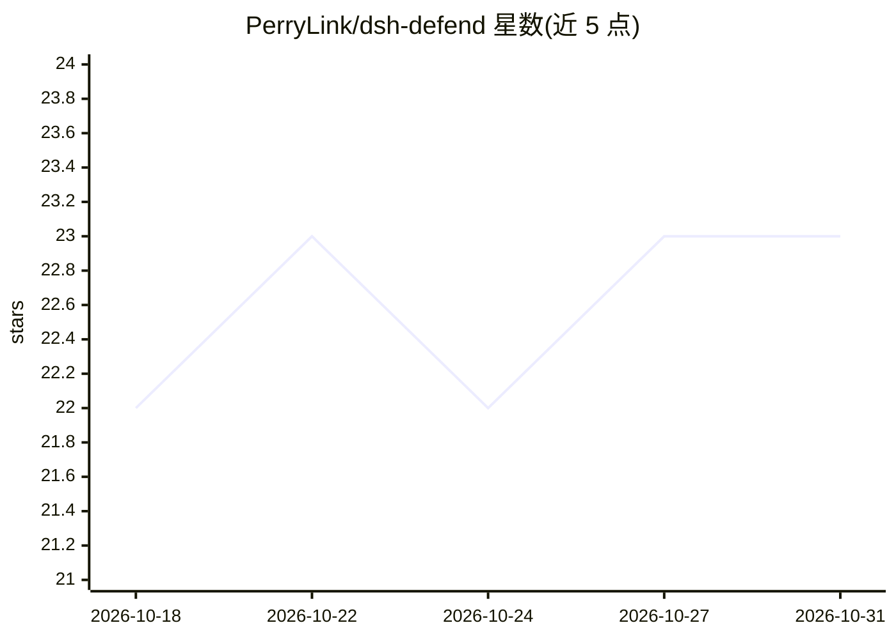

# PerryLink/dsh-defend

⭐ 23 · TypeScript · Apache-2.0 · 推送 2026-10-27 · [GitHub](https://github.com/PerryLink/dsh-defend) · [官网](https://perrylink.github.io/plugins/dsh-defend/) · 个人维护 · 中文 README

**DeepSeek Harness 的提示注入/越狱/密钥泄露防御插件**

面向 DeepSeek Harness（DSH）的 cordis 插件，在用户消息、工具参数、工具结果三个拦截点做检测：纯 TypeScript Aho-Corasick 自动机运行 25 条注入规则、25 条越狱模式与 12 种密钥语法，配 allow/ask/block 三档决策与 fail-closed 默认；另有递归删除命令防护。检测确定性执行、不调用模型、不联网，审计事件脱敏（仅记录规则 id 与判定，不记命中文本）。维护状态为 2026-10-05 起 FROZEN，不再新增功能，仅修复真实故障。

## 筛选速览

| 维度 | 判定 | 备注 |
|---|---|---|
| AI 角色 | `ai-ecosystem` | LLM/agent 周边工具 |
| 许可风险 | `permissive` | Apache-2.0 |
| 部署形态 | `library` | 以包/库形式分发 |
| 模型依赖 | locked-api |  |
| 硬件要求 | — | 无带数字的原话,不猜 |
| 安装摩擦 | `low` | 无编译、无系统依赖或容器化 |
| 成熟度 | — | 结构信号不足 |

## 能力要点

- 三拦截点（入站消息/工具参数/工具结果）allow/ask/block 检测
- Aho-Corasick 引擎：25 注入规则+25 越狱模式+12 密钥语法
- 递归删除命令防护（要求显式绝对路径，白名单前缀保护）
- 确定性本地扫描，不调用模型，审计事件脱敏，fail-closed

## 适用场景

- 给 DeepSeek Harness agent 加提示注入与越狱输入拦截
- 阻止工具调用中的递归删除命令与密钥泄露
- 留存脱敏的检测审计记录供事后核查

## 场景标签

`网络安全` · 领域:学习与行业

## 证据(README 行号)

> L44: Prompt-injection, jailbreak, and secret-leak defense for DeepSeek Harness.
> L90: `dsh-defend` puts two independent layers in front of the agent:

## 星数曲线

2026-10-18 22 → 2026-10-31 23（+1）

---
*卡片 v1 · prompt 1.4 · 生成 2026-10-27 · 置信度 high · 依据 README sha `529f72995b23` · [字段定义](../../DATASET.md)*
