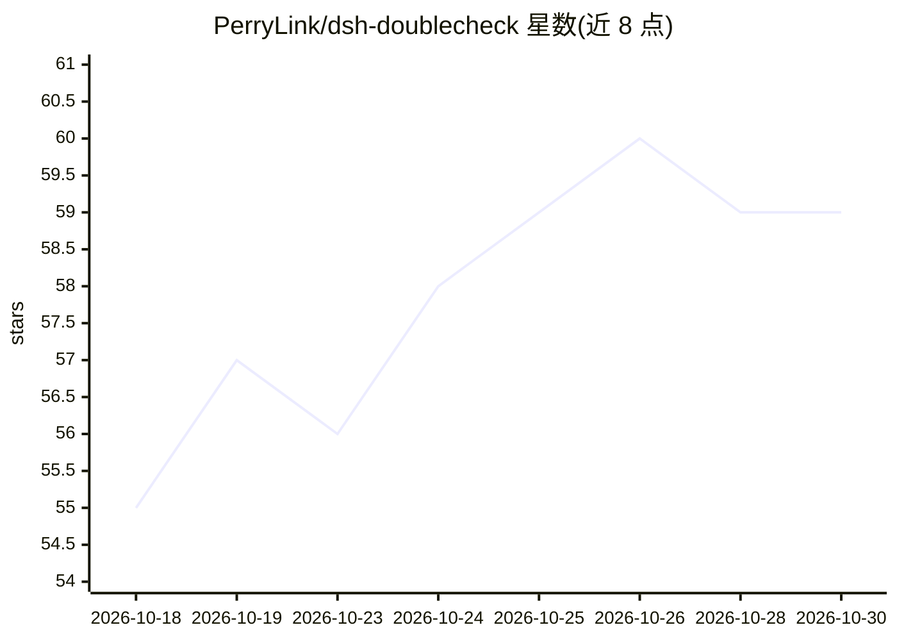

# PerryLink/dsh-doublecheck

⭐ 59 · TypeScript · Apache-2.0 · 推送 2026-10-26 · [GitHub](https://github.com/PerryLink/dsh-doublecheck) · [官网](https://perrylink.github.io/plugins/dsh-doublecheck/) · 个人维护 · 中文 README

**DeepSeek Harness 的交付质量门插件：拷问需求、测试实现、证明交付**

面向 DeepSeek Harness（dsh）的工程纪律插件包，安装后提供 doublecheck-grill 与 doublecheck-guard 两个插件行，实施 grill→design→red→green→review→verify 六阶段纪律循环：先对六个需求维度拷问并达成共识才允许实现，用失败/通过测试运行作为证据，最后由批评子代理与门控命令（/doublecheck、/gate）给出 deliverable/rework 裁决。门守本身不调用模型，批评与复核阶段以 harness 子代理运行；支持 remind/warn/block 三档强度与零配置 strict 覆盖层。给使用 dsh 的开发者做交付把关。

## 筛选速览

| 维度 | 判定 | 备注 |
|---|---|---|
| AI 角色 | `ai-ecosystem` | LLM/agent 周边工具 |
| 许可风险 | `permissive` | Apache-2.0 |
| 部署形态 | `library` | 以包/库形式分发 |
| 模型依赖 | locked-api |  |
| 硬件要求 | — | 无带数字的原话,不猜 |
| 安装摩擦 | `low` | 无编译、无系统依赖或容器化 |
| 成熟度 | — | 结构信号不足 |

## 能力要点

- 六阶段纪律循环：grill→design→red→green→review→verify
- /doublecheck 与 /gate 命令输出 deliverable/rework 门控裁决
- red/green 证据门要求失败与通过测试运行作为交付证据
- strict.patch.yml 零配置全门 block 强度覆盖层

## 适用场景

- 在 AI agent 开发流程中先拷问需求再动手实现
- 用测试证据门阻止无验证的交付
- 通过对抗性复核审查实现是否符合规格

## 场景标签

`代码审查` · 领域:编码与开发

## 证据(README 行号)

> L46: The delivery quality gate for DeepSeek Harness: grill the requirements, test the implementation, prove the delivery
> L65: `dsh-doublecheck` installs two plugin rows that read and enforce from the same durable session log:
> L67: 1. **`doublecheck-grill`** — the requirements furnace: the bundled `grill-requirements` skill plus the model-facing

## 星数曲线

2026-10-18 55 → 2026-10-30 59（+4）

---
*卡片 v1 · prompt 1.4 · 生成 2026-10-24 · 置信度 high · 依据 README sha `9b28565409c8` · [字段定义](../../DATASET.md)*
