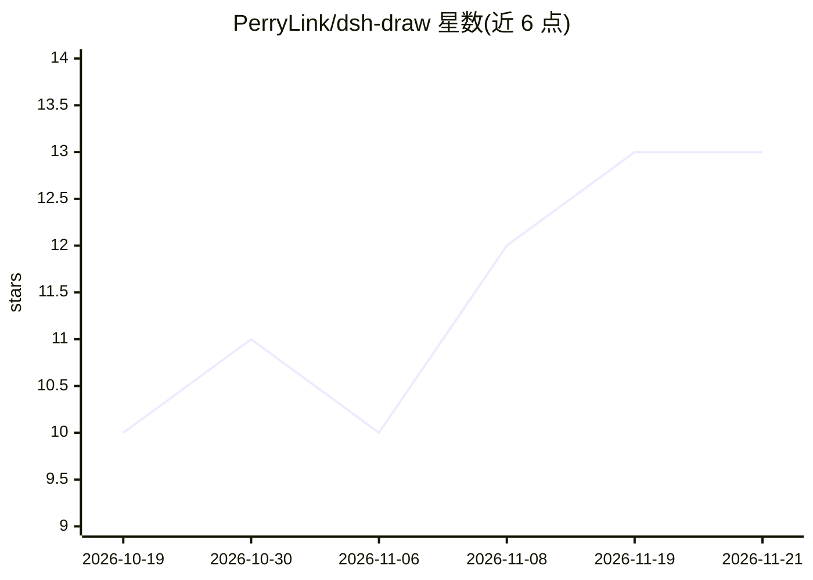

# PerryLink/dsh-draw

⭐ 13 · TypeScript · Apache-2.0 · 推送 2026-11-18 · [GitHub](https://github.com/PerryLink/dsh-draw) · [官网](https://www.npmjs.com/package/dsh-draw) · 个人维护 · 中文 README

**DeepSeek Harness 的统一静态图像生成路由插件**

为 DeepSeek Harness 提供单一 image_generate 工具的图像生成路由插件：按配置的引擎链（OpenAI Images、智谱 CogView、任意 OpenAI 兼容端点）自上而下调用，连续失败触发冷却并切换到下一个健康引擎；生成图像以内容寻址附件持久保存，按会话统计生成次数与字节配额，API key 以环境变量名引用而非明文存储。通过 dsh plugin 命令安装，含网页结果卡片与设置页。2026-10-05 起冻结，仅修复真实故障。

## 筛选速览

| 维度 | 判定 | 备注 |
|---|---|---|
| AI 角色 | `ai-ecosystem` | LLM/agent 周边工具 |
| 许可风险 | `permissive` | Apache-2.0 |
| 部署形态 | `library` | 以包/库形式分发 |
| 模型依赖 | — | README 未给出锁定关系 |
| 硬件要求 | — | 无带数字的原话,不猜 |
| 安装摩擦 | `low` | 无编译、无系统依赖或容器化 |
| 成熟度 | — | 结构信号不足 |

## 能力要点

- 配置驱动的多引擎链与健康感知回退（冷却机制）
- 生成图像作为持久工作区附件保存
- 按会话的生成次数与字节双重配额门控
- API key 以环境变量引用，不落配置、不入日志

## 适用场景

- 让 DeepSeek Harness 的 agent 通过对话生成图像
- 在多个图像引擎间自动回退保证可用性
- 为会话级图像生成设置用量上限

## 场景标签

`图像生成` · 领域:内容生成

## 证据(README 行号)

> L5: **Unified static-image generation routing for DeepSeek Harness.**
> L99: `dsh-draw` gives the harness one unified `image_generate` tool with standard parameters (`prompt`/`size`/`count`/`q
> L101: - **Multi-engine routing** — a config-driven chain (OpenAI Images, Zhipu CogView, or any OpenAI-compatible endpoin

## 星数曲线

2026-10-19 10 → 2026-11-21 13（+3）

---
*卡片 v1 · prompt 1.4 · 生成 2026-11-18 · 置信度 high · 依据 README sha `fb214b79876c` · [字段定义](../../DATASET.md)*
