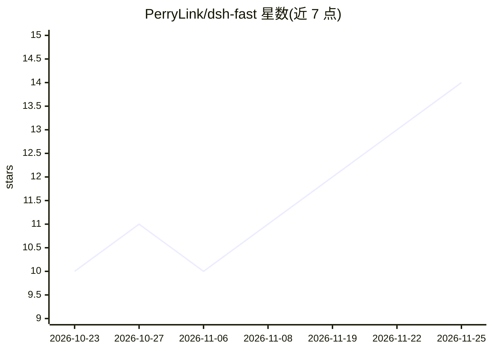

# PerryLink/dsh-fast

⭐ 14 · TypeScript · Apache-2.0 · 推送 2026-11-23 · [GitHub](https://github.com/PerryLink/dsh-fast) · [官网](https://www.npmjs.com/package/dsh-fast) · 个人维护 · 中文 README

**DeepSeek Harness 会话性能诊断插件：拆解延迟与缓存命中**

面向 DeepSeek Harness 的只读性能诊断插件，通过监听 session/created、session/event、session/disposed 三个事件做 O(1) 折叠，并按定时器采样，输出会话加载耗时、spill 命中数、compaction 次数与触发原因、系统提示词/工具 schema/会话表面的 token 占比，以及由 provider usage 聚合的 LLM 缓存命中率。指标持久化到 dsh_fast 存储域而非会话日志，支持 /fast --history 回看趋势，报告标识展示前脱敏，插件本身不发网络请求。依赖宿主 dsh-v0.2.2-rc.4 与 Node ^22.19.0||>=24。

## 筛选速览

| 维度 | 判定 | 备注 |
|---|---|---|
| AI 角色 | `ai-ecosystem` | LLM/agent 周边工具 |
| 许可风险 | `permissive` | Apache-2.0 |
| 部署形态 | `library` | 以包/库形式分发 |
| 模型依赖 | locked-api |  |
| 硬件要求 | — | 无带数字的原话,不猜 |
| 安装摩擦 | `low` | 无编译、无系统依赖或容器化 |
| 成熟度 | — | 结构信号不足 |

## 能力要点

- 一条 /fast 输出加载耗时、spill、compaction、上下文体量与缓存命中率五段报告
- 严格只读：事件 O(1) 折叠加定时器采样，不进入模型请求路径
- 指标写入 dsh_fast 存储域，可经 /fast --history 回看采样趋势
- 阈值驱动的优化建议与 fast_report 结构化 JSON 工具

## 适用场景

- 排查一次会话为何加载慢或延迟高
- 分析系统提示词与工具 schema 占用的上下文预算
- 观察 LLM 缓存命中率是否过低并调整策略

## 场景标签

`LLM 可观测性` · 领域:评测与运维

## 证据(README 行号)

> L7: 面向 DeepSeek Harness 的只读性能诊断插件：只观察会话事件流，不碰模型热路径，把会话加载、spill、compaction、上下文注入与 LLM 缓存的开销拆开给你看。
> L32: `dsh-v0.2.2-rc.4`（2026-11-18）；`dsh-fast` 是给 DeepSeek Harness 会话做的一次体检：一条 `/fast` 就能看到这次会话的加载耗时、有多少工具结果被 spill、compa
> L241: 本 README 面向 DeepSeek Harness `dsh-v0.2.2-rc.4`（2026-11-18）；`0.2.2-rc.4`（运行时兼容面见「兼容性」）。本插件只注册一个命令（`/fast`）、一个工具（`fa

## 星数曲线

2026-10-23 10 → 2026-11-25 14（+4）

---
*卡片 v1 · prompt 1.4 · 生成 2026-11-19 · 置信度 mid · 依据 README sha `ccd25c11af94` · [字段定义](../../DATASET.md)*
