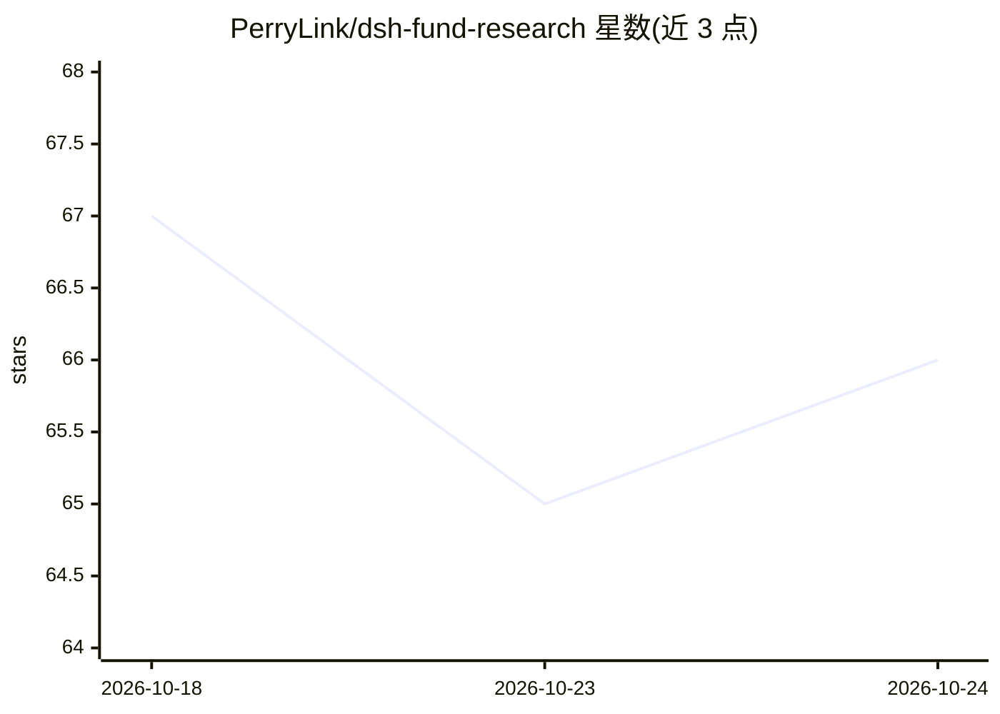

# PerryLink/dsh-fund-research

⭐ 66 · TypeScript · Apache-2.0 · 推送 2026-10-24 · [GitHub](https://github.com/PerryLink/dsh-fund-research) · [官网](https://perrylink.github.io/plugins/dsh-fund-research/) · 个人维护 · 中文 README

**为 DeepSeek Harness 生成中国公募基金确定性研究报告的插件**

DeepSeek Harness（dsh）插件，面向中国公募基金研究：输入基金代码，输出带版本封存的 Markdown 研究报告，含业绩分解、持仓穿透、风格归因、经理画像与数据缺口声明。核心指标（收益率、波动率、最大回撤、Sharpe、HHI 等）全部由纯函数在封存快照上计算，模型不做算术；每个关键数字可回溯到快照 JSON 路径并有核查结论。数据来自天天基金/东方财富公开接口，无需 key；支持离线模式、asOf 截断、断点续跑与多基金扇出。仅供研究，非投资建议。

## 筛选速览

| 维度 | 判定 | 备注 |
|---|---|---|
| AI 角色 | `ai-ecosystem` | LLM/agent 周边工具 |
| 许可风险 | `permissive` | Apache-2.0 |
| 部署形态 | `library` | 以包/库形式分发 |
| 模型依赖 | locked-api |  |
| 硬件要求 | — | 无带数字的原话,不猜 |
| 安装摩擦 | `low` | 无编译、无系统依赖或容器化 |
| 成熟度 | — | 结构信号不足 |

## 能力要点

- 指标全部由代码计算，零模型算术，关键数字可回溯到快照路径并带核查结论
- 报告封存为版本目录（report.md + manifest.json + snapshot.json），含数据缺口声明
- 支持离线模式、asOfDate 截断、断点续跑与多基金扇出
- 数据源为天天基金/东方财富公开接口，无需 key

## 适用场景

- 输入基金代码生成可审计的基金研究报告
- 在无网络环境下复现既有报告或做测试
- 批量对多只基金跑研究流水线并汇总结果

## 场景标签

`金融量化` `科研工具` · 领域:学习与行业

## 证据(README 行号)

> L7: **Deterministic research reports for Chinese public mutual funds, on DeepSeek Harness.**
> L45: Deterministic research reports for Chinese public mutual funds, on DeepSeek Harness.
> L67: - **Deterministic metrics, zero model arithmetic** — period/annualized return, volatility, max drawdown, Sharpe; to

## 星数曲线

2026-10-18 67 → 2026-10-24 66（-1）

---
*卡片 v1 · prompt 1.4 · 生成 2026-10-24 · 置信度 high · 依据 README sha `f4a8780630d9` · [字段定义](../../DATASET.md)*
