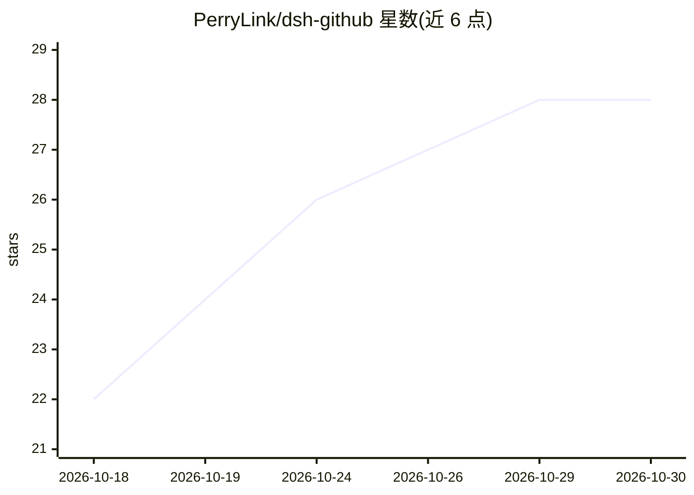

# PerryLink/dsh-github

⭐ 28 · TypeScript · Apache-2.0 · 推送 2026-10-27 · [GitHub](https://github.com/PerryLink/dsh-github) · [官网](https://perrylink.github.io/plugins/dsh-github/) · 个人维护

**DeepSeek Harness 的 GitHub 插件：PR/issue/CI 工具与审批门控**

面向 DeepSeek Harness（DSH）agent 宿主的 GitHub 集成插件：提供 15 个工具与 4 组命令，覆盖 PR 创建/更新/合并、行锚定评审、issue 操作与代码搜索；附带 CI 复合 action、轮询评审 bot 与状态检查门。所有写操作经 ctx.approval 人工审批（默认 ask、失败即关），token 经凭证/环境/gh CLI 三级解析且不落日志。评审引擎默认静态确定性分析，可选 model 模式走宿主 subagent。通过 dsh plugin 命令以 git/npm/tarball 三渠道安装。

## 筛选速览

| 维度 | 判定 | 备注 |
|---|---|---|
| AI 角色 | `ai-ecosystem` | LLM/agent 周边工具 |
| 许可风险 | `permissive` | Apache-2.0 |
| 部署形态 | `library` | 以包/库形式分发 |
| 模型依赖 | — | README 未给出锁定关系 |
| 硬件要求 | — | 无带数字的原话,不猜 |
| 安装摩擦 | `low` | 无编译、无系统依赖或容器化 |
| 成熟度 | — | 结构信号不足 |

## 能力要点

- 15 个 GitHub 工具覆盖 PR 全生命周期、issue、搜索与状态检查读取
- 所有写操作经人工审批门控（fail-closed）并受写动作白名单限制
- CI 复合 action + 轮询评审 bot（幂等行内评论）+ 状态检查门
- token 经 credentials/env/gh 三级解析，不进入日志与错误输出

## 适用场景

- 让 DSH agent 在人工审批下创建、评审、合并 PR 与管理 issue
- 在 CI 中跑 AI PR 评审并用状态检查门挡住需修改的提交
- 给 agent 提供带 token 保密机制的 GitHub 只读检索能力

## 场景标签

`代码审查` · 领域:编码与开发

## 证据(README 行号)

> L65: `dsh-github` fills the GitHub gap between `dsh` and tools like Claude Code and Codex: your agent can read, review, 
> L67: - **15 tools** — `pr_create`, `pr_merge`, `pr_update`, `gh_review`, `review_post`, `gh_issue`, `issue_open`, `issue
> L204: - **CI composite action / review bot / status-check gate.** The repo ships a composite action (`action.yml`) that 

## 星数曲线

2026-10-18 22 → 2026-10-30 28（+6）

---
*卡片 v1 · prompt 1.4 · 生成 2026-10-26 · 置信度 high · 依据 README sha `6622c43de1db` · [字段定义](../../DATASET.md)*
