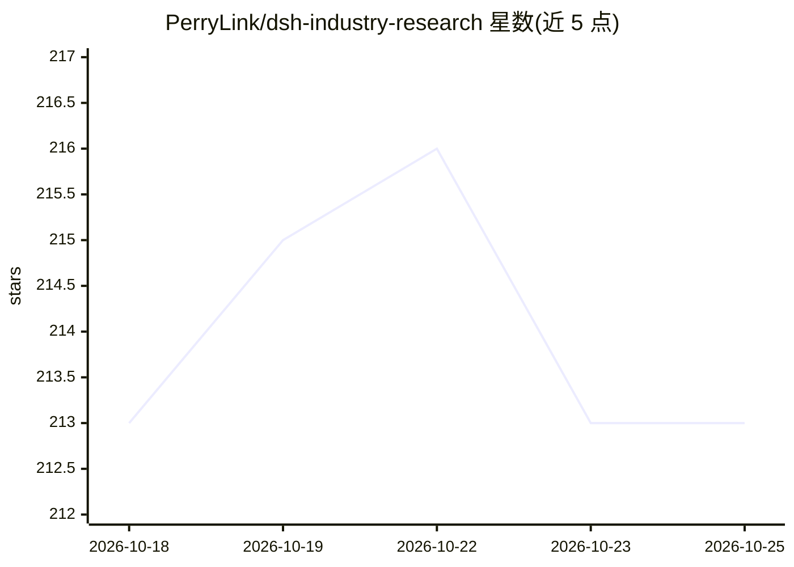

# PerryLink/dsh-industry-research

⭐ 214 · TypeScript · Apache-2.0 · 推送 2026-10-24 · [GitHub](https://github.com/PerryLink/dsh-industry-research) · [官网](https://perrylink.github.io/plugins/dsh-industry-research/) · 个人维护 · 中文 README

**给 DeepSeek Harness 用户的行业/公司研究插件：带溯源的可审计研究报告**

面向 DeepSeek Harness（dsh）的领域插件包，提供四个工具：industry_map 构建并校验产业链图（含 SVG 渲染与缺口声明）、industry_track 经 ctx.web 做公开来源政策/新闻跟踪（SHA-256 快照、去重、来源黑白名单）、company_scan 从工作区文件生成带逐行引用的公司卡片、industry_report 按确定性交付契约产出可审计报告。每个数值须携带来源引用，未溯源值触发失败；工件写入 versions.jsonl 版本账本并校验哈希。附两个方法论技能。声明仅做研究支持、不构成投资建议，不使用付费/登录墙来源。安装经 dsh plugin 或 1024 store 渠道，需 Node 22+，ESM only。

## 筛选速览

| 维度 | 判定 | 备注 |
|---|---|---|
| AI 角色 | `ai-ecosystem` | LLM/agent 周边工具 |
| 许可风险 | `permissive` | Apache-2.0 |
| 部署形态 | `library` | 以包/库形式分发 |
| 模型依赖 | locked-api |  |
| 硬件要求 | — | 无带数字的原话,不猜 |
| 安装摩擦 | `low` | 无编译、无系统依赖或容器化 |
| 成熟度 | — | 结构信号不足 |

## 能力要点

- 产业链图/时间线/公司卡片/报告四工具，数值必须携带来源引用否则失败
- 公开来源快照带 SHA-256 溯源哈希，工件写入版本账本并做哈希校验
- 确定性交付契约与 bull/bear 多视角综合，无引擎时诚实标注 builtin-fallback
- 两个方法论技能与类型化 Cordis 事件

## 适用场景

- 让 agent 按可溯源流程做行业产业链研究与报告
- 跟踪某行业的公开政策与新闻并留存带哈希快照的时间线
- 从本地工作区文件生成每个数字可溯源到文件与行号的公司卡片

## 场景标签

`科研工具` · 领域:学习与行业

## 证据(README 行号)

> L7: **Industry and company research domain pack for DeepSeek Harness.**
> L58: - DeepSeek Harness `dsh-v0.2.1-alpha.1` (published npm line, verified 2026-09-25; peers `>=0.1.2-rc.1 <0.2.0 || >=0
> L67: - **`industry_map`** — build or update an industry chain map (`chain.json`): upstream/midstream/downstream nodes, e

## 星数曲线

2026-10-18 213 → 2026-10-25 213（+0）

---
*卡片 v1 · prompt 1.4 · 生成 2026-10-22 · 置信度 high · 依据 README sha `d9522f5bf5d6` · [字段定义](../../DATASET.md)*
