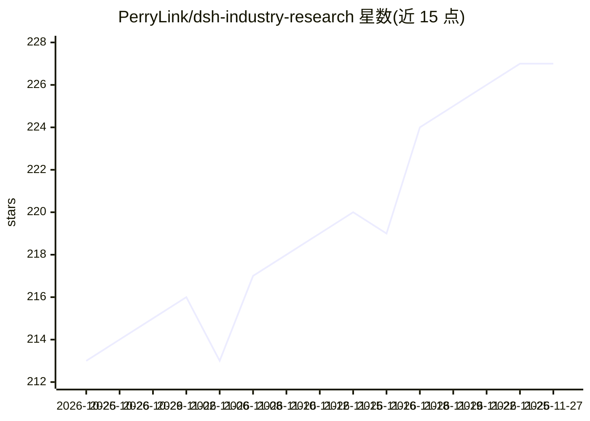

# PerryLink/dsh-industry-research

⭐ 227 · TypeScript · Apache-2.0 · 推送 2026-11-23 · [GitHub](https://github.com/PerryLink/dsh-industry-research) · [官网](https://www.npmjs.com/package/dsh-industry-research) · 个人维护 · 中文 README

**面向 DeepSeek Harness 的行业/公司研究领域包，产出可核查报告**

以 DeepSeek Harness 插件形式分发，注入四个工作区工具与两个方法论技能：先建产业链结构图，再经 ctx.web 跟踪公开源政策要闻，扫描公司数据文件出速览卡，最后组装报告。每个带值指标必须带 sourceRef，缺口为显式槽位；产物落盘写入 versions.jsonl 并做 SHA-256 校验，报告走封存引擎或内置降级路径并标注 claims unverified。只读公开源、不接交易、不解析 PDF、本地计算不调用模型。

## 筛选速览

| 维度 | 判定 | 备注 |
|---|---|---|
| AI 角色 | `ai-native` | 本体是模型或模型工具 |
| 许可风险 | `permissive` | Apache-2.0 |
| 部署形态 | `library` | 以包/库形式分发 |
| 模型依赖 | locked-api |  |
| 硬件要求 | — | 无带数字的原话,不猜 |
| 安装摩擦 | `low` | 无编译、无系统依赖或容器化 |
| 成熟度 | — | 结构信号不足 |

## 能力要点

- 四个工具（industry_map/track/scan/report）组成可回放的研究流水线
- 证据登记簿逐份 SHA-256 溯源，versions.jsonl 读取时校验哈希
- 交付契约校验不过即响亮失败，缺 ctx.web/researchReport 时如实降级
- 含来源主机白/黑名单与离线模式配置

## 适用场景

- 为行业研究建立带来源与日期的产业链结构图
- 跟踪某行业的公开政策与要闻并留快照哈希
- 从工作区文本数据生成带来源的公司速览卡
- 组装每个数字可回溯的证据链式研究报告

## 场景标签

`科研工具` · 领域:学习与行业

## 证据(README 行号)

> L9: 面向 DeepSeek Harness 的行业/公司研究领域包：四个工作区工具 + 两个方法论技能，只读公开源，只做研究支持。
> L40: `dsh-industry-research` 把行业研究拆成一条可回放的流水线：先建产业链结构图，再跟踪公开源政策与要闻，然后扫描公司出速览卡，最后组装成可核查报告。每个带值的指标必须带 `sourceRef`，每个缺口是显式槽
> L90: - **`industry_report`** —— 汇总结构图、时间线与公司卡产出可核查报告。产出前跑确定性交付契约校验（区块、状态/价格断言、占位符残留；不通过即响亮失败，绝不交付半成品）。时间线条目按 `evidenceCa

## 星数曲线

2026-10-25 213 → 2026-11-27 227（+14）

---
*卡片 v1 · prompt 1.4 · 生成 2026-11-25 · 置信度 high · 依据 README sha `a9fef7e0c9b4` · [字段定义](../../DATASET.md)*
