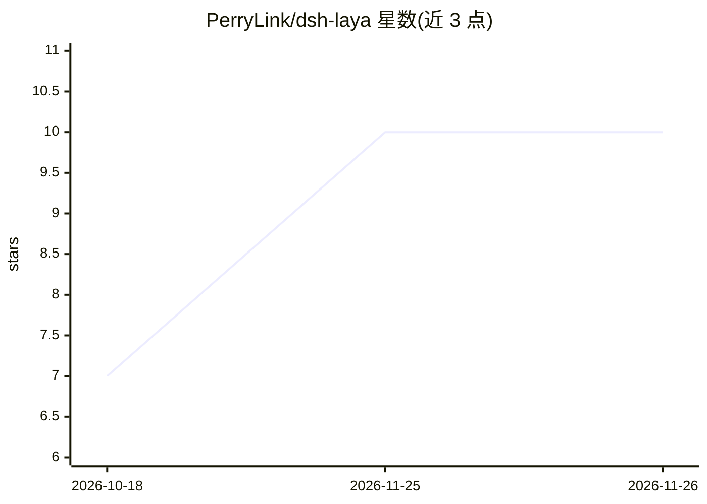

# PerryLink/dsh-laya

⭐ 10 · JavaScript · Apache-2.0 · 推送 2026-11-24 · [GitHub](https://github.com/PerryLink/dsh-laya) · [官网](https://perrylink.github.io/plugins/dsh-laya/) · 个人维护 · 中文 README

**将 Laya 决策模型接入 DeepSeek Harness 的插件，state 不出本机**

DeepSeek Harness 的社区插件（0.1.9），把 Laya 有类型决策模型（noul/choice/score）以一等 Cordis 服务 ctx.laya 与两个模型可见工具 laya_ask/laya_plan 暴露给 Host。插件本身不含模型权重、不跑推理，只是到 Python sidecar（laya-mcp serve，PyTorch）的回环 HTTP 客户端；提供预算预检、失败语义（sidecar_unreachable/timeout）、sidecar 生命周期管理与并发声明。默认端点 127.0.0.1:8787，插件无遥测、不落盘。上游文档自述基础 checkpoint 零样本接近随机，score 最弱。

## 筛选速览

| 维度 | 判定 | 备注 |
|---|---|---|
| AI 角色 | `ai-ecosystem` | LLM/agent 周边工具 |
| 许可风险 | `permissive` | Apache-2.0 |
| 部署形态 | `desktop` | 安装包/桌面程序 |
| 模型依赖 | locked-api |  |
| 硬件要求 | — | 无带数字的原话,不猜 |
| 安装摩擦 | `medium` | 含编译或系统依赖之一 |
| 成熟度 | `idea` | |

## 能力要点

- ctx.laya 服务与 laya_ask/laya_plan 两个模型可见工具
- budget 预检（POST /plan 不跑前向传播）
- 默认回环端点 127.0.0.1:8787，state 默认不出本机
- sidecar 生命周期 never/attach/spawn 三档与失败语义透传

## 适用场景

- 给 DeepSeek Harness 的 agent 增加本地有类型判断（是/否、选标签、打分）
- 让模型在花一次前向传播前先用 laya_plan 检查预算
- 在 Harness 插件生态中共享本地 Laya sidecar 服务

## 场景标签

`Agent 框架` · 领域:Agent 开发

## 证据(README 行号)

> L33: Laya 是一个只回答有类型判断的模型：`noul` 给出「真」的概率，`choice` 从你命名的标签里挑一个，`score` 在你声明、按升序排好的刻度上定位。`dsh-laya` 不持有权重——Laya 是 PyTorch，
> L9: Laya 的有类型决策（`noul`、`choice`、`score`）以一等 Cordis 服务 `ctx.laya` 与两个模型可见工具 `laya_ask` / `laya_plan` 接入 DeepSeek Harness：
> L35: 它向 Harness 贡献两样东西：服务 `ctx.laya`（`ask`、`plan`、`health`、`capabilities`、`sidecarUrl`、`loopback`），以及两个模型可见工具 `laya_ask`

## 星数曲线

2026-10-18 7 → 2026-11-26 10（+3）

---
*卡片 v1 · prompt 1.4 · 生成 2026-11-24 · 置信度 mid · 依据 README sha `49f26f9e1fd2` · [字段定义](../../DATASET.md)*
