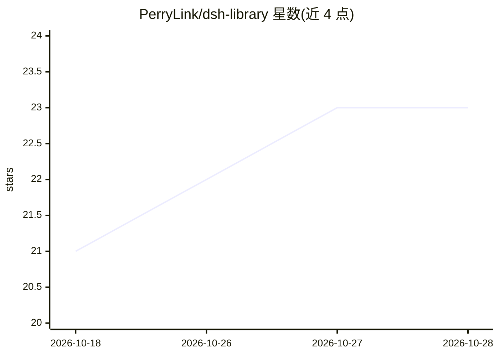

# PerryLink/dsh-library

⭐ 23 · TypeScript · Apache-2.0 · 推送 2026-10-26 · [GitHub](https://github.com/PerryLink/dsh-library) · [官网](https://perrylink.github.io/plugins/dsh-library/) · 个人维护 · 中文 README

**DeepSeek Harness 的本地文档知识库插件：检索带可核验引用**

面向 DeepSeek Harness（DSH）的插件，将本地 md/txt 文档转为可查询知识库：library_add/remove/list 按路径导入并分块嵌入，library_search 做语义+关键词混合排序、MMR 多样性重排、相关性过滤与 lost-in-the-middle 规避，可注入调用方 agent；library_cite_check 以模糊匹配+语义相似度核验回答中的 [n] 引用，library_diagnose 输出分块统计与自检索探针。索引存于宿主存储域（JSON/SQLite），内置确定性哈希嵌入器，零模型下载、零网络请求；可选外部命令或本地 Ollama 作为嵌入后端。仅支持 md/txt，不含 PDF/docx 解析。

## 筛选速览

| 维度 | 判定 | 备注 |
|---|---|---|
| AI 角色 | `ai-ecosystem` | LLM/agent 周边工具 |
| 许可风险 | `permissive` | Apache-2.0 |
| 部署形态 | `library` | 以包/库形式分发 |
| 模型依赖 | local-ok | 支持本地模型 |
| 硬件要求 | — | 无带数字的原话,不猜 |
| 安装摩擦 | `low` | 无编译、无系统依赖或容器化 |
| 成熟度 | — | 结构信号不足 |

## 能力要点

- 混合语义+关键词检索，MMR 多样性重排与 lost-in-the-middle 规避
- library_cite_check 用模糊 token 匹配+语义相似度核验 [n] 引用
- 内置确定性哈希嵌入器：零模型下载、零网络调用
- library_remove 带清除验证：用签名探针报告索引残留

## 适用场景

- 给 DeepSeek Harness agent 挂载本地文档知识库并注入带 [n] 引用的检索结果
- 核验 agent 回答中的引用是否真实对应检索页
- 诊断知识库分块质量与重复内容

## 场景标签

`RAG` `知识库管理` · 领域:知识与检索

## 证据(README 行号)

> L7: **Local document knowledge base for DeepSeek Harness.**
> L24: dsh plugin --profile <name> add dsh-library
> L70: - **`library_search`** — hybrid semantic + keyword ranking, maximal-marginal-relevance diversity re-rank, relevance

## 星数曲线

2026-10-18 21 → 2026-10-28 23（+2）

---
*卡片 v1 · prompt 1.4 · 生成 2026-10-27 · 置信度 high · 依据 README sha `3a61bdba4157` · [字段定义](../../DATASET.md)*
