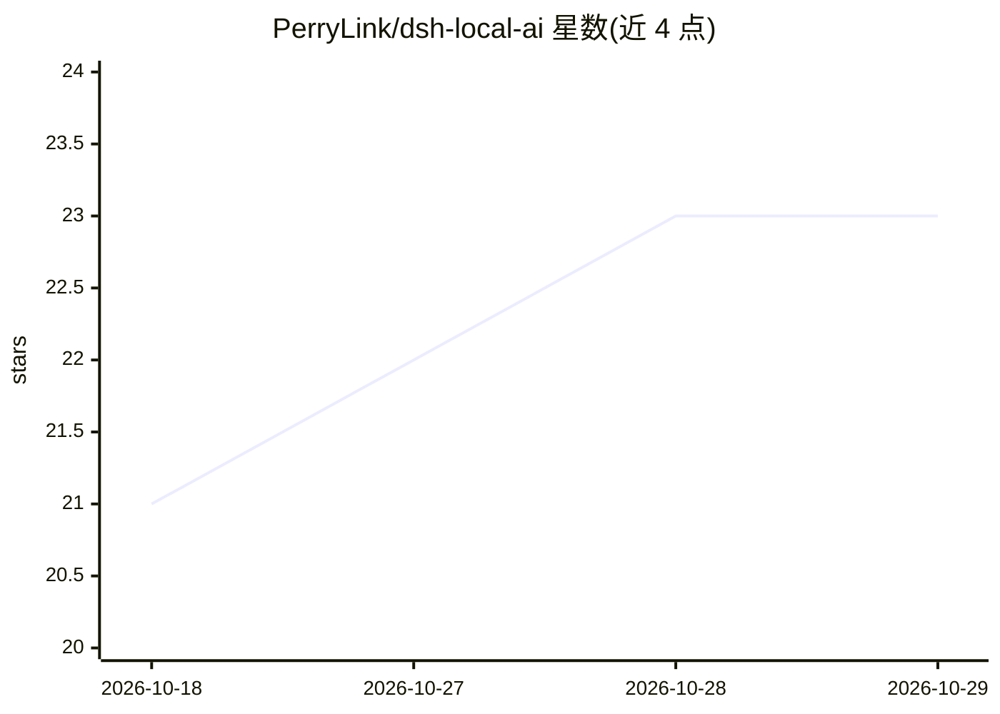

# PerryLink/dsh-local-ai

⭐ 23 · TypeScript · Apache-2.0 · 推送 2026-10-27 · [GitHub](https://github.com/PerryLink/dsh-local-ai) · [官网](https://perrylink.github.io/plugins/dsh-local-ai/) · 个人维护 · 中文 README

**DeepSeek Harness 的 Ollama 本地模型集成插件**

面向 DeepSeek Harness（dsh）的插件：把 Ollama 注册为一等本地 provider，提供 ollama_list/show/pull/remove/health 五个工具与 /ollama 状态命令；通过 model_route 规则按任务类型、关键词或 always 将请求路由到本地模型，首 token 前失败自动回退云端。同一条 LlmAdapter 通道还可把 LM Studio、vLLM、llama.cpp 注册为 openai:<name> 后端。零依赖、纯 HTTP 调用，不捆绑模型文件。要求 Node ^22.19 || >=24。

## 筛选速览

| 维度 | 判定 | 备注 |
|---|---|---|
| AI 角色 | `ai-ecosystem` | LLM/agent 周边工具 |
| 许可风险 | `permissive` | Apache-2.0 |
| 部署形态 | `library` | 以包/库形式分发 |
| 模型依赖 | local-ok | 支持本地模型 |
| 硬件要求 | — | 无带数字的原话,不猜 |
| 安装摩擦 | `low` | 无编译、无系统依赖或容器化 |
| 成熟度 | — | 结构信号不足 |

## 能力要点

- Ollama 官方适配器注册（模型映射、temperature/max-tokens/stop 翻译）
- 按任务类型/关键词/always 的本地路由规则，首 token 前失败自动回退云端
- LM Studio / vLLM / llama.cpp 经 OpenAI 兼容适配器注册为 openai:<name> 后端
- ollama_list/show/pull/remove/health 五个工具与 /ollama 一次性状态命令

## 适用场景

- 在 DeepSeek Harness 中用本地 Ollama 模型替代云端处理部分请求
- 把压缩、会话标题等任务固定路由到本地小模型以节省云端调用
- 通过 /ollama 一条命令查看本地模型、磁盘占用与健康状态

## 场景标签

`模型网关` · 领域:Agent 开发

## 证据(README 行号)

> L66: `dsh-local-ai` makes Ollama a first-class local provider in DeepSeek Harness:
> L70: - **Official adapter** — the `ollama` provider route is registered through `ctx.llm.registerAdapter` (`LlmAdapter`)
> L71: - **OpenAI-compatible backends** — LM Studio, vLLM, and llama.cpp `--server` each register as their own `openai:<na

## 星数曲线

2026-10-18 21 → 2026-10-29 23（+2）

---
*卡片 v1 · prompt 1.4 · 生成 2026-10-27 · 置信度 high · 依据 README sha `c8597c3d8162` · [字段定义](../../DATASET.md)*
